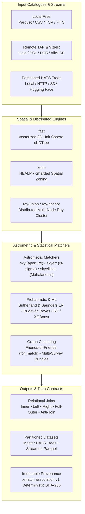

# xmatcher Documentation

Welcome to the `xmatcher` documentation suite. `xmatcher` is a high-performance astronomical catalogue crossmatching toolkit built on Polars, PyArrow, and 3D unit-sphere KD-trees with native support for local files, remote TAP services, and distributed HATS trees.

---

## Architecture Overview

---

## Documentation Pathways

### 1. Getting Started & User Guides

- **[User Guide & Practical Cookbooks](usage.md)**
  End-to-end guide covering installation, local and remote crossmatching, memory-bounded disk spilling, and distributed execution.
- **[CLI Reference Manual](cli.md)**
  Complete documentation for all command-line interface subcommands (`match`, `list`, `describe`, `discover`, `search`, `adopt`, `sync`, `project-hats`, `completion`, `doctor`) and arguments.
- **[Python API Reference](api.md)**
  Comprehensive reference for `CrossMatch`, `MatchRequest`, `MatchSpec`, engine configurations, relational join modes, and exceptions.

---

### 2. Scientific Rigor & Algorithms

- **[Algorithms & Mathematical Foundations](algorithms.md)**
  Rigorous derivations of 3D unit-sphere chord distances, error ellipses (Mahalanobis metric), Sutherland & Saunders Likelihood Ratios, Budavári & Szalay Bayes factors, proper-motion epoch kinematics, and machine-learning matchers.
- **[Catalogue Naming & Resolution Grammar](naming.md)**
  Specification of canonical survey identifiers, short aliases, and explicit registry prefixes (`vizier:<id>`, `tap:<endpoint>/<table>`, `hats:<url>`).

---

### 3. Distributed Computing & Large Surveys

- **[HATS Catalogue Sources](hats-sources.md)**
  IVOA registry lookups, verified LSDB/IRSA datasets, and remote read capabilities across HTTP, AWS S3 (`s3://`), and Hugging Face Hub (`hf://`).
- **[Anchor-Centric Master Catalogues (`ray-anchor`)](ray-anchor.md)**
  Distributed one-row-per-anchor-source master catalogue generation with multi-survey counterpart ranking, ambiguity metrics, and HATS spatial partitioning.

---

### 4. Data Contracts & Architecture

- **[Association Contract v1 (`xmatch.association.v1`)](association-v1.md)**
  Normative specification for versioned association tables, directory layouts, component sidecars, deterministic SHA-256 identities, and cross-release member equivalence.
- **[Source & Measurement Releases](observations.md)**
  Architecture for lazy measurement ledgers, photometric unit normalization, property evidence, and checksummed Parquet releases.
- **[Catalogue-to-Model Pipeline](catalogue-pipeline.md)**
  Data flow architecture transforming raw survey observations into sparse candidate sets and physical target association hypotheses.

---

### 5. Historical Archive & Benchmark Reports

- **[0.6.0 Release Notes](archive/release-0.6.0.md)** — Named catalogues, S3/HF HATS streaming, `skyerr` radius bounds, and upgrade guide.
- **[0.5.1 Migration Notes](archive/release-0.5.1.md)** — Namespace migration from `xmatch` to `xmatcher`.
- **[0.5.0 Release Notes](archive/release-0.5.0.md)** — Initial 0.5.0 release features.
- **[Documentation & CLI Audit (2026-10-21)](archive/audit-2026-10-21.md)** — Verification findings and naming migration records.
- **[CANFAR Scaling Report (2026-10-07)](archive/canfar-scaling-2026-10-07.md)** — Benchmark results and scaling curves.
- **[0.5.0 Release Audit (2026-10-06)](archive/release-audit-2026-10-06.md)** — Pre-release verification logs.
