# xmatcher documentation

Start with the [project README](../README.md) for an overview and a quickstart.

```mermaid
flowchart LR
    subgraph IN["Inputs"]
        F1["Local files<br/>Parquet · CSV/TSV · FITS · HATS"]
        F2["Remote archives<br/>TAP · VizieR · CDS XMatch"]
        F3["Remote HATS trees<br/>HTTPS · S3 · Hugging Face<br/>(mirrored to a local cache)"]
    end

    subgraph SEARCH["Candidate search"]
        E1["fast / zone<br/>torchsky declination-zone index"]
        E2["astropy · stilts<br/>reference engines"]
        E3["ray · ray-union · ray-anchor<br/>Ray cluster, HEALPix partitions"]
    end

    subgraph SCORE["Scoring and association"]
        M1["sky · skyerr · skyellipse"]
        M2["lr · N-way Bayesian · ml / xgb · auf"]
        M3["Friends-of-Friends"]
    end

    subgraph OUT["Outputs"]
        O1["Joins: inner · outer · left · right · anti"]
        O2["Parquet · CSV · FITS · HATS"]
        O3["Versioned association releases"]
    end

    IN --> SEARCH --> SCORE --> OUT
```

## Using xmatcher

- [Installation](install.md): pip and the optional extras, the Pixi developer
  environment, platform notes.
- [User guide](usage.md): formats and storage, remote archives and discovery,
  local mirroring, the matcher cookbook, joins and multi-catalogue chains,
  choosing an execution path, Friends-of-Friends.
- [CLI reference](cli.md): every subcommand (`match`, `list`, `describe`,
  `discover`, `search`, `adopt`, `sync`, `project-hats`, `export-hats`,
  `convert`, `completion`, `doctor`) and its options.
- [Python API](api.md): `CrossMatch`, `MatchRequest`, `MatchSpec`, the engines,
  I/O helpers, mirroring, association records and exceptions.

## Methods

- [Algorithms](algorithms.md): geometry and candidate search, positional error
  models, epoch propagation, likelihood ratios, Bayesian and N-way association,
  machine-learned matchers, Friends-of-Friends, and their practical limits.
- [Catalogue naming](naming.md): the naming grammar, aliases, and explicit
  `vizier:`, `tap:` and `hats:` identifiers.

## Large surveys

- [HATS sources](hats-sources.md): registry lookups, verified remote trees,
  and reading over HTTPS, S3 and Hugging Face.
- [Gaia-anchored masters](ray-anchor.md): one row per anchor source, built on
  a Ray cluster from HATS inputs.

## Data contracts

- [Association contract v1](association-v1.md): the normative layout and
  identity rules of `xmatch.association.v1` releases.
- [Source and measurement releases](observations.md): measurement ledgers,
  photometric normalisation, property evidence and checksummed releases.
- [Catalogue-to-model pipeline](catalogue-pipeline.md): from survey
  observations to candidate sets and association hypotheses.

## Release notes and reports

- [0.7.0](archive/release-0.7.0.md): torchsky matching engine, catalogue
  conversion, release audit.
- [0.6.0](archive/release-0.6.0.md): named catalogues, HATS over S3 and Hugging
  Face, Gaia-anchored masters.
- [0.5.1](archive/release-0.5.1.md): rename from `xmatch` to `xmatcher`.
- [0.5.0](archive/release-0.5.0.md): first release.
- [Documentation and CLI audit, 2026-10-21](archive/audit-2026-10-21.md)
- [CANFAR scaling report, 2026-10-07](archive/canfar-scaling-2026-10-07.md)
- [0.5.0 release audit, 2026-10-06](archive/release-audit-2026-10-06.md)

The full history is in the [changelog](../CHANGELOG.md).
