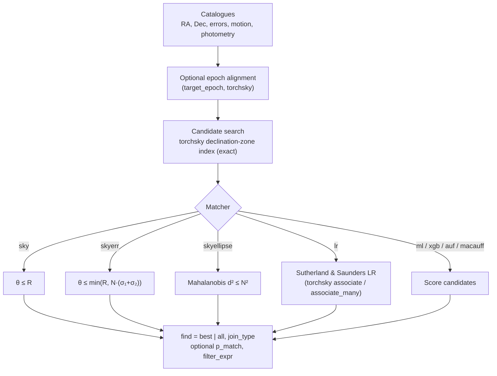
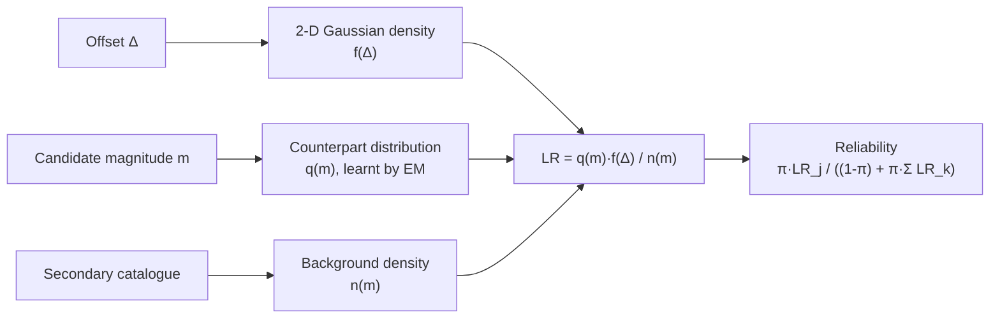
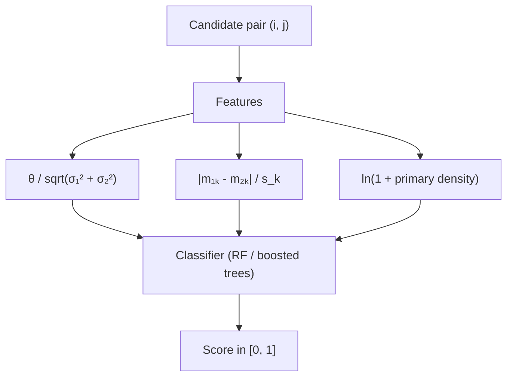
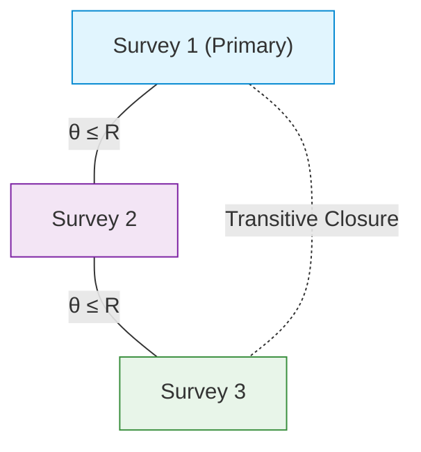
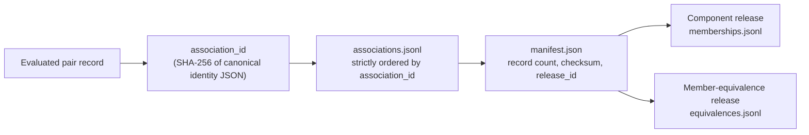

# Crossmatch algorithms & mathematical foundations

The candidate search, matchers, scores and epoch handling implemented in `xmatcher`, with the formulas the code evaluates.

---

## 1. Introduction & architecture

### The astronomical challenge

Crossmatching catalogues differs from a relational `JOIN`:

- **Spherical geometry**: sources lie on the celestial sphere, where planar coordinate arithmetic fails near the poles and across RA = 0/360.
- **Astrometric uncertainties**: errors range from sub-milliarcsecond (Gaia) to arcseconds (ground-based seeing, radio, X-ray).
- **Proper motion**: decade-long baselines between surveys move stars by arcseconds.
- **Different resolutions and bandpasses**: an optical source (0.5″ PSF) may correspond to a radio component (5″ beam) or a blended WISE centroid (6″).
- **Crowded fields**: in dense regions (Galactic bulge, globular clusters, Magellanic Clouds) chance alignments become likely.

### Processing pipeline

Publishing evaluated pairs as content-addressed records is a separate step ([section 9](#9-provenance-identity-deterministic-association-xmatchassociationv1)).

---

## 2. Algorithm capabilities & selection guide

| Matcher | Required inputs | Criterion or score | Output columns | Typical use |
|---|---|---|---|---|
| `matcher="sky"` | RA, Dec | Great-circle separation $\theta \le R$ | `sep_arcsec` | Uniform search radius. |
| `matcher="skyerr"` | RA/Dec errors or `default_pos_error_arcsec` | $\theta \le \min(R, N_\sigma(\sigma_1+\sigma_2))$ | `sep_arcsec` | Positional errors that vary row to row. |
| `matcher="skyellipse"` | Errors plus correlation, or 5-parameter covariance | Mahalanobis $d_{\text{M}}^2 \le N_\sigma^2$ | `sep_arcsec` | Anisotropic or correlated errors. |
| `matcher="lr"`, two catalogues | `lr_magnitude_column`; errors optional | Likelihood ratio and reliability | `lr`, `reliability` | Low-resolution (radio, X-ray) against dense optical/IR catalogues. |
| `matcher="lr"` with $\ge 3$ catalogues, `nway_match()` | Errors in every catalogue; magnitudes (required for `matcher="lr"`) | $N$-way hypothesis posterior | `reliability` or `p_match`, `lr`, `p_any`, `nway_best`, `sep_arcsec_<k>` | Simultaneous multi-survey association. |
| `probabilistic=True` or `prior_columns` | Errors on both sides | Pairwise Bayesian posterior | `p_match` | Extra score on the final pairs of any pairwise matcher. |
| `matcher="ml"` | `ml_color_columns` | Random-forest score | `ml_score` | Ranking with colour features. |
| `matcher="xgb"` | `ml_color_columns` | Gradient-boosted-tree score | `xgb_score` | As `ml`, with boosted trees. |
| `matcher="auf"` | RA, Dec | Background-subtracted separation histogram | `auf_prob` | Empirical radial offset model. |
| `matcher="macauff"` | RA, Dec; optional `macauff_flux_columns` | `auf` odds times magnitude-difference ratios | `macauff_prob` | `auf` with photometric re-weighting. |
| `fof_match()` | RA, Dec, $\ge 2$ catalogues | Connected components of the match graph | `bundle_id`, `n_cats`, `_src_cats` | Grouping blends or multi-catalogue bundles. |

$R$ is `radius_arcsec` and $N_\sigma$ is `max_error` (default 3). `matcher="lr"` (two catalogues) requires `lr_magnitude_column`; `skyerr` and `skyellipse` without error metadata on both sides fall back to `sky` with a warning, or fail under `fallback_policy="error"` (and always for target-epoch `skyerr`).

---

## 3. Candidate search

The engines and their limits are listed in the [API reference](api.md#execution-engines). The `fast` and `zone` engines, the Ray tasks of `engine="ray"` and `ray-anchor` all use torchsky's declination-zone index (`SkyIndex`); `astropy` uses `match_to_catalog_sky` for `sky` with `find="best"` and `search_around_sky` otherwise.

### Declination-zone index

`SkyIndex.build` sorts the right catalogue once by (zone, right ascension), where zones are declination bands of height $h$. A left row with window radius $W$ scans the zones that meet $[\delta - W, \delta + W]$ and, in each, one right-ascension interval of half-width $\arcsin(\sin W / \cos\delta)$; a window that reaches a pole scans the full circle, and an interval crossing RA 0/360 is split. The candidate set is always a superset of the true pairs, whatever $h$ is; $h$ changes only the cost, $O((N + M)\log M + K)$ for $K$ candidates, which are processed in bounded batches.

Each candidate passes a padded chord prefilter, $\|\mathbf{r}_1 - \mathbf{r}_2\|^2 \le 4\sin^2(W/2)$ (see the chord relation below), and is accepted on its exact great-circle separation (atan2 form, float64). torchsky returns these exact separations; `xmatcher` reports them in arcseconds as `sep_arcsec`. Every engine applies the same matcher filters and tie-breaks, so `find="best"` keeps the lowest right-row index among equally good counterparts.

### Search radius per matcher

The radius passed to the search depends on the matcher:

- `sky`, `lr`, `ml`, `xgb`, `auf`, `macauff`: $R$.
- `skyerr`: $\min\left(R,\; N_\sigma(\max_i \sigma_{1,i} + \max_j \sigma_{2,j})\right)$, followed by the per-pair test in [section 4B](#b-sigma-adaptive-matching-matcherskyerr).
- `skyellipse`: the covariance bound of [section 4C](#c-sky-ellipse--mahalanobis-distance-matcherskyellipse), capped at $R$.

For `matcher="lr"` torchsky's `associate` runs its own gated search; the engine's candidate list is not used.

### Unit-vector chord search (scipy cKDTree paths)

`fof_match` with `matcher="sky"`, the `ray-union` neighbourhood search and the local-density feature of `ml`/`xgb` use a scipy `cKDTree` on 3-D unit vectors (the same chord relation gives the zone index's prefilter):

$$
\mathbf{r} = (\cos\delta\cos\alpha,\; \cos\delta\sin\alpha,\; \sin\delta)
$$

A chord $d = \|\mathbf{r}_1 - \mathbf{r}_2\|$ and the great-circle angle $\theta$ satisfy

$$
d = 2\sin\left(\frac{\theta}{2}\right), \qquad \theta = 2\arcsin\left(\frac{d}{2}\right).
$$

The search chord is $2\sin(\theta_{\text{radius}}/2)$, with $\theta_{\text{radius}}$ capped at $180^\circ$, so the chord ball contains exactly the points within the angular radius.

### Multi-dimensional ranking (`extra_distance_cols`)

With `find="best"` and `extra_distance_cols={"phot_g_mean_mag": 0.5}`, the `fast`, `zone` and `ray` engines collect every candidate that passes the matcher's spatial test and keep, per primary row, the one with the smallest

$$
D^2 = \|\mathbf{r}_1 - \mathbf{r}_2\|^2 + \sum_k \left(w_k\,\frac{c_{1,k} - c_{2,k}}{s_k}\right)^2
$$

where $w_k$ is the column weight and $s_k$ the population standard deviation of column $k$ over both catalogues combined (1 when it is zero). The spatial term is the squared chord in radians, which is negligible next to any non-zero photometric term at arcsecond scales: within the radius, the choice is effectively photometric.

---

## 4. Astrometric & distance matchers

### A. Simple positional matching (`matcher="sky"`)

A pair $(i, j)$ is a candidate when $\theta(i, j) \le R$. `find="best"` keeps $j^* = \arg\min_j \theta(i, j)$; `find="all"` keeps every candidate.

Worked examples for every matcher in this section, with the per-side error columns they need, are in the [user guide cookbook](usage.md#4-crossmatch-algorithm-cookbook).

---

### B. Sigma-adaptive matching (`matcher="skyerr"`)

The admission radius scales with the positional errors of each pair. Each row's radial error is

$$
\sigma = \sqrt{\sigma_{\alpha*}^2 + \sigma_\delta^2}
$$

The RA error column is used as given, as the tangent-plane (east) error $\sigma_{\alpha*}$; it is not multiplied by $\cos\delta$. Errors are converted with the catalogue's `pos_err_units`. Other sources of $\sigma$:

- `default_pos_error_arcsec` $= \sigma_0$ is a per-axis floor: $\sigma \leftarrow \max(\sigma, \sqrt{2}\,\sigma_0)$, or $\sqrt{2}\,\sigma_0$ alone when the catalogue has no error columns.
- With only 5-parameter covariance columns, $\sigma = \sqrt{C_{\alpha*\alpha*} + C_{\delta\delta}}$.
- At a target epoch, $\sigma = \sqrt{\operatorname{tr} \mathbf{C}_{\text{pos}}(t)}$ from the propagated covariance ([section 5A](#a-epoch-propagation-target_epoch)).
- A drift prior ([section 5B](#b-assumed-kinematic-drift-prior-pm_priortrue-wilson-2023)) is added in quadrature.

A pair is admitted when

$$
\theta \le \min\left(R,\; N_\sigma(\sigma_1 + \sigma_2)\right)
$$

The two errors add linearly, not in quadrature. Rows with a non-finite limit are rejected. For `find="best"` candidates are ranked by

$$
\text{rank} = \frac{\theta}{\min\left(R,\; N_\sigma(\sigma_1 + \sigma_2)\right)}
$$

which is $\theta / (N_\sigma(\sigma_1+\sigma_2))$ whenever the radius cap is inactive. The rank is used internally and is not written to the output.

> [!CAUTION]
> `radius_arcsec` is a hard ceiling. Some catalogues contain corrupt errors (Pan-STARRS1 DR1 has rows with `e_RAJ2000` of hundreds of arcseconds); the ceiling keeps such rows from accepting counterparts outside the requested radius.

---

### C. Sky ellipse & Mahalanobis distance (`matcher="skyellipse"`)

The full $2\times 2$ positional covariance of each row is used.

#### Covariance of each row

In arcsec², on the row's own (east, north) axes:

$$
\mathbf{C}_i = \begin{pmatrix} \sigma_{\alpha*,i}^2 & \rho_i\sigma_{\alpha*,i}\sigma_{\delta,i} \\ \rho_i\sigma_{\alpha*,i}\sigma_{\delta,i} & \sigma_{\delta,i}^2 \end{pmatrix}
$$

taken from, in order of preference: RA/Dec error columns with the optional `corr_column` ($\rho = 0$ without it); the positional block of the 5-parameter `astrometric_covariance_columns`; or the isotropic floor $\sigma_0^2$. The floor also bounds each diagonal term from below, a propagated target-epoch covariance replaces the reference-epoch one where it is valid, and a drift prior adds $\sigma_{\text{drift}}^2/2$ to each diagonal term.

#### Pair offset and joint covariance

The offset is resolved on the tangent plane at the pair's midpoint $\hat{\mathbf{m}} = (\mathbf{r}_1 + \mathbf{r}_2)/\|\mathbf{r}_1 + \mathbf{r}_2\|$, with east and north axes $(\hat{\mathbf{e}}_m, \hat{\mathbf{n}}_m)$, and scaled so that its length is the exact arc:

$$
\Delta\mathbf{r} = \frac{\theta}{\|\mathbf{r}_1 - \mathbf{r}_2\|}\begin{pmatrix} (\mathbf{r}_1 - \mathbf{r}_2)\cdot\hat{\mathbf{e}}_m \\ (\mathbf{r}_1 - \mathbf{r}_2)\cdot\hat{\mathbf{n}}_m \end{pmatrix}
$$

Each covariance is rotated from its row's axes to the midpoint axes, $\mathbf{C}_i' = \mathbf{M}_i \mathbf{C}_i \mathbf{M}_i^T$, where $\mathbf{M}_i$ holds the projections of $(\hat{\mathbf{e}}_m, \hat{\mathbf{n}}_m)$ on the row's own east and north vectors. This stays correct near the poles, where $\Delta\alpha\cos\bar\delta$ does not. The joint covariance is

$$
\mathbf{C} = \mathbf{C}_1' + \mathbf{C}_2' = \begin{pmatrix} C_{11} & C_{12} \\ C_{12} & C_{22} \end{pmatrix}
$$

and

$$
d_{\text{M}}^2 = \Delta\mathbf{r}^T\mathbf{C}^{-1}\Delta\mathbf{r} = \frac{C_{22}\Delta x^2 - 2C_{12}\Delta x\Delta y + C_{11}\Delta y^2}{C_{11}C_{22} - C_{12}^2}
$$

A pair is admitted when $d_{\text{M}}^2 \le N_\sigma^2$ and $\theta \le R$. Pairs with a singular joint covariance (determinant $\le 10^{-30}$ arcsec⁴) are rejected. `find="best"` keeps the smallest $d_{\text{M}}^2$.

#### Search radius

With $A = \max\sigma_{\alpha*,1}^2 + \max\sigma_{\alpha*,2}^2$ and $D = \max\sigma_{\delta,1}^2 + \max\sigma_{\delta,2}^2$ over all rows, the candidate radius is

$$
\min\left(R,\; N_\sigma\sqrt{A + D + \sqrt{AD}}\right)
$$

which bounds the largest eigenvalue of any joint covariance, so no admissible pair is missed.

---

## 5. Kinematics & proper motion propagation

### A. Epoch propagation (`target_epoch`)

All epoch propagation calls torchsky (`torchsky.wcs`); coordinates must be ICRS.

- **Angular motion** (`propagate_proper_motion`): proper motions $(\mu_{\alpha*}, \mu_\delta)$ in mas/yr, with $\mu_{\alpha*}$ already including $\cos\delta$, are applied by unit-distance Cartesian propagation, as astropy's `SkyCoord.apply_space_motion` does without distance and radial velocity. To first order in $\Delta t = t - t_0$ (years), $\Delta\alpha\cos\delta \approx \mu_{\alpha*}\Delta t$ and $\Delta\delta \approx \mu_\delta\Delta t$; the propagation itself stays exact at the poles.
- **Space motion** (`propagate_space_motion`): used for rows with finite parallax $> 0$ and radial velocity when the catalogue declares both columns and the implied speed is below $c/2$; other rows take the angular path.
- **Covariance** (`skyellipse` and `skyerr`): the five-parameter covariance $\mathbf{C}_5$ of $(\alpha*, \delta, \mu_{\alpha*}, \mu_\delta, \varpi)$ is transported with the Jacobian $\mathbf{J}$ of the propagated position,

$$
\mathbf{C}_{\text{pos}}(t) = \mathbf{J}\,\mathbf{C}_5\,\mathbf{J}^T
$$

  using the first four parameters on the angular path. Target-epoch `skyerr` requires this covariance and, for the space-motion path, `release_metadata["radial_velocity_uncertainty"] = "deterministic"`; missing motion on rows away from the target epoch is an error.

For matchers other than `skyerr`, a NaN proper motion on the angular path is treated as zero and a NaN reference epoch as the target epoch, and a catalogue without proper-motion columns or epoch is left at its stored positions (unless `pm_prior` applies).

---

### B. Assumed kinematic drift prior (`pm_prior=True`, Wilson 2023)

Faint stars often lack measured proper motions. With `pm_prior=True` and a `target_epoch`, catalogues that declare an epoch but no proper-motion columns receive an assumed drift uncertainty, following the approach of Wilson (2023). The coefficients below are `xmatcher`'s own assumed model; they have not been checked against that paper.

The assumed 1-D proper-motion dispersion at Galactic latitude $b$ (computed from the J2000 Galactic pole) is

$$
\sigma_\mu(b) = 3 + 7\exp\left(-\frac{|b|}{20^\circ}\right) \quad [\text{mas/yr}]
$$

With `pm_prior_magnitude_column`, it is multiplied by a distance proxy (missing magnitudes count as 15):

$$
S(m) = \operatorname{clip}\left(10^{-0.2(m - 15)},\; 0.3,\; 3.0\right)
$$

The drift over the baseline is

$$
\sigma_{\text{drift}} = \sigma_\mu(b)\,S(m)\,\frac{|\Delta t|}{1000} \quad [\text{arcsec}]
$$

It is added in quadrature to the radial error used by `skyerr`, `lr`, `ml`, `xgb`, `auf` and `p_match`, and as $\sigma_{\text{drift}}^2/2$ to each tangent-plane variance for `skyellipse` and the $N$-way association. A catalogue whose baselines are all below 0.01 yr is left unchanged. The bounded-memory (spill) path rejects `pm_prior`.

---

## 6. Probabilistic & Bayesian matchers

### A. Sutherland & Saunders (1992) likelihood ratio (`matcher="lr"`)

The two-catalogue LR matcher calls torchsky's `associate` with the primary as the left catalogue. It suits cross-identification of a low-resolution catalogue against a dense optical/IR one, where a candidate's magnitude carries information beyond its offset.

#### Likelihood ratio

$$
LR_{ij} = \frac{q(m_j)\,f(\Delta_{ij})}{n(m_j)}
$$

**Positional density $f$**: the surface density (per arcsec²) of an isotropic 2-D Gaussian,

$$
f(\Delta) = \frac{1}{2\pi\sigma^2}\exp\left(-\frac{\Delta^2}{2\sigma^2}\right), \qquad \sigma^2 = \frac{\sigma_1^2 + \sigma_2^2}{2}
$$

where $\sigma_1, \sigma_2$ are the radial errors of [section 4B](#b-sigma-adaptive-matching-matcherskyerr) (0.5″ when a catalogue has none), so $\sigma^2$ is the combined per-axis variance. $f$ peaks at zero offset. The Rayleigh density $2\pi\Delta f(\Delta)$ is the density of the offset length, not a surface density, and would make $LR$ vanish for a coincident counterpart.

**Background $n(m)$**: the secondary catalogue's surface density $\nu$ over its footprint (a HEALPix order-10 coverage map built from its positions) times the magnitude distribution of all its sources, $n(m) = \nu\,b(m)$.

**Counterpart distribution $q(m)$**: learnt by EM from the match posteriors. $b$ and $q$ are histograms of the secondary's `lr_magnitude_column` with $\min(50, \lfloor\sqrt{n}\rfloor)$ bins spanning its finite values. With fewer than 10 finite magnitudes the LR is positional only (a warning is logged). With `lr_color_column`, the feature is the colour $m_2 - m_1$ (secondary magnitude minus that primary column), and both distributions are learnt from the candidate pairs.

#### Gate and reliability

Candidates pass a $\chi^2_2$ gate, $d_{\text{M}}^2 \le k^2$ with $k^2$ the $1 - 10^{-4}$ quantile, and $\theta \le R$. The reliability of candidate $j$ of primary $i$ is the posterior

$$
R_{ij} = \frac{\pi\,LR_{ij}}{(1 - \pi) + \pi\sum_k LR_{ik}}, \qquad \pi = Q\,(1 - 10^{-4})
$$

where $Q$ = `lr_q` (default 0.8) is the prior probability that a primary has a counterpart in the secondary catalogue. torchsky's default exclusive model also discounts $LR_{ij}$ by the probability that no other primary takes $j$ (belief propagation); this changes the result only where primaries share candidates. `find="best"` keeps each primary's highest-reliability candidate.

---

### B. Bayesian pairwise probabilistic qualifier (`probabilistic=True`)

`p_match` compares the hypothesis that a pair is one source, $H_{\text{match}}$, with chance alignment inside the search disc, $H_{\text{bg}}$. It is computed on the final pairs of the pairwise matcher (after `find` and `filter_expr`), each pair on its own: it is not normalised over competing candidates. Both catalogues need positional errors or `default_pos_error_arcsec`. `prior_columns` alone also requests it.

#### 1. Positional likelihoods

With the radial errors $\sigma_1, \sigma_2$ of [section 4B](#b-sigma-adaptive-matching-matcherskyerr), the per-axis variance is $\sigma_{\text{eff}}^2 = (\sigma_1^2 + \sigma_2^2)/2$ and

$$
p(\theta \mid H_{\text{match}}) = \frac{1}{2\pi\sigma_{\text{eff}}^2}\exp\left(-\frac{\theta^2}{2\sigma_{\text{eff}}^2}\right), \qquad p(\theta \mid H_{\text{bg}}) = \frac{1}{\pi R^2}
$$

#### 2. Photometric KDE terms

For each `prior_columns` entry present in both catalogues, a Gaussian KDE (scipy, Scott bandwidth) is fit to the finite values of both full catalogues combined, subsampled to 50,000 values. Under $H_{\text{match}}$ the KDE is evaluated at the pair midpoint; under $H_{\text{bg}}$ the two values are independent draws:

$$
\mathcal{L}_{\text{match}} = \ln p(\theta \mid H_{\text{match}}) + \sum_k \ln\text{KDE}_k\left(\frac{m_{1,k} + m_{2,k}}{2}\right)
$$

$$
\mathcal{L}_{\text{bg}} = \ln p(\theta \mid H_{\text{bg}}) + \sum_k\left[\ln\text{KDE}_k(m_{1,k}) + \ln\text{KDE}_k(m_{2,k})\right]
$$

The midpoint term is an empirical heuristic, not a calibrated likelihood. A column missing on one side is skipped; a KDE that cannot be fit counts as a uniform prior.

#### 3. Posterior

With equal prior odds,

$$
p_{\text{match}} = \frac{1}{1 + \exp\left(-(\mathcal{L}_{\text{match}} - \mathcal{L}_{\text{bg}})\right)}
$$

---

### C. Simultaneous $N$-way association (`nway_match`, `matcher="lr"` with $N \ge 3$)

Chaining pairwise matches ($A \times B \times C$) accumulates false associations and depends on catalogue order. The $N$-way association (nway-style, computed by torchsky's `associate_many`) scores, for each primary source (catalogue 1), every combination of one gated counterpart **or none** per other catalogue. A source missing from one survey is a hypothesis, not a lost match.

#### Hypothesis weight

A hypothesis $h$ with present secondary catalogues $S$ has weight

$$
w_h = \prod_{c \in S}\frac{\pi_c\,\rho_c}{\nu_c}\prod_{c \notin S}(1 - \pi_c)\; M_S
$$

- $M_S$ is the exact Gaussian marginal likelihood that all present positions (the primary's included) come from one true position with a flat prior, using each row's full $2\times 2$ covariance (Budavári & Szalay 2008, eq. 18, generalised from isotropic errors). Every catalogue needs positional errors or `default_pos_error_arcsec`.
- $\pi_c$ is catalogue $c$'s completeness times the gate acceptance $1 - 10^{-4}$. With `matcher="lr"` the completeness is `lr_q` (default 0.8); `nway_match` fits it by EM unless `lr_q` is given.
- $\nu_c$ is catalogue $c$'s background surface density over its footprint.
- $\rho_c = q_c/b_c$ is the photometric ratio of the member (1 without terms): the secondary's magnitude (`lr_magnitude_column`, or `lr_magnitude_column_<n>` for catalogue $n$), the colour against `lr_color_column`, and, for `nway_match`, one colour term secondary − primary per `prior_columns` entry. Each is a histogram ratio learnt by EM, as in [section 6A](#a-sutherland--saunders-1992-likelihood-ratio-matcherlr).

Candidates pass the same $\chi^2_2$ gate ($p = 10^{-4}$) and the `radius_arcsec` ceiling. A secondary catalogue with no gated pair is left out (completeness 0). Each secondary source is the counterpart of at most one primary (Bethe posteriors of that constraint). Primaries with more hypotheses than the budget (4096 for `matcher="lr"`; `max_tuples_per_source`, default 10,000, for `nway_match`, where 0 means no limit) are enumerated best-first, and the posterior mass left out is bounded rather than silently dropped.

`matcher="lr"` with three or more catalogues accepts `join_type="1and2"` or `"all1"` (which adds a null-score row for each primary without a counterpart) and rejects `filter_expr`, `extra_distance_cols`, `prior_columns` and `probabilistic`.

#### Outputs

One row per hypothesis with at least one counterpart (`find="best"`: the primary's MAP hypothesis only), ordered by primary and decreasing posterior:

- `p_match` (`nway_match`) or `reliability` (`matcher="lr"`): the hypothesis posterior, normalised over all of the primary's hypotheses including "no counterpart".
- `lr`: $w_h / w_\emptyset$ with the completeness priors divided out, $\prod_{c\in S}\rho_c\, M_S / \prod_{c\in S}\nu_c$. With two catalogues this is the pairwise `matcher="lr"` likelihood ratio, and the posterior equals its reliability.
- `p_any`: probability that the primary has at least one counterpart; `nway_best`: the hypothesis is the primary's MAP one.
- `sep_arcsec_<k>`: separation of catalogue $k$'s member from the primary ($k \ge 2$; null when absent).

---

## 7. Machine learning matchers (`matcher="ml"`, `matcher="xgb"`)

The classifiers are trained on the fly from pseudo-labels derived from the candidates themselves, or loaded from a saved model. Their scores rank candidates; they are not calibrated probabilities.

### Features

For each candidate pair:

1. **Normalised separation**: $\theta / \sqrt{\sigma_1^2 + \sigma_2^2}$, with the radial errors of [section 4B](#b-sigma-adaptive-matching-matcherskyerr) (0.5″ when a catalogue has none).
2. **Colour differences**: for each `ml_color_columns` entry present in both catalogues, $|m_{1,k} - m_{2,k}| / s_k$, where $s_k$ is the standard deviation of that absolute difference over the candidate pairs.
3. **Local density**: the number of primary-catalogue sources within $2R$ of the primary (itself included), divided by $\pi(2R)^2$, entered as $\ln(1 + \rho)$.

### Training

- **Pseudo-labels**: per primary, the candidate with the smallest normalised separation is positive; every other candidate is negative. Up to 1000 random primary/secondary pairings separated by more than $10R$ (fixed seed) are added as further negatives.
- **Models**: `matcher="ml"` uses scikit-learn's `RandomForestClassifier` (balanced class weights). `matcher="xgb"` uses XGBoost, else LightGBM, else scikit-learn's `GradientBoostingClassifier`. Both use $\min(100, \max(10, n_{\text{pairs}}/5))$ trees of depth $\min(5, \max(2, \lfloor\log_2(n_{\text{features}} + 1)\rfloor))$.
- **Fallbacks**: without colour columns on both sides, or with fewer than two positive labels, the nearest candidate is kept with score $1/(1 + \theta)$. Without any classifier library, the score is $1/(1 + 2x_0 + \sum_{k>0} x_k)$ over the features $x$.
- **Model files**: `ml_model_path` / `xgb_model_path` (CLI `--ml-model-path` / `--xgb-model-path`). An existing file is loaded with `joblib` and used without retraining (a file that cannot be used is an error); otherwise the trained model is saved there.

Because the positive labels are nearest neighbours, a trained model largely learns to reproduce the nearest-neighbour choice, adjusted by colour and density.

---

## 8. Graph clustering: Friends-of-Friends (`fof_match`)

Friends-of-Friends takes the transitive closure of pairwise matches: if $A$ matches $B$ and $B$ matches $C$, all three form one bundle.

### Procedure

1. **Edges**: for every pair of catalogues, all matches with `find="all"`: a scipy `cKDTree` chord search for `matcher="sky"`, the `fast` engine with the matcher's filter otherwise, or the `ray` engine with `engine="ray"`. Edges join sources of different catalogues only.
2. **Components**: `scipy.sparse.csgraph.connected_components`, $O(|V| + |E|)$. Components are numbered in order of their lowest node, so a bundle's id is fixed by its first primary row.
3. **Bundles**: components with at least one primary source are kept, one row each. The first primary row's columns are kept unchanged. For each other catalogue, float columns are NaN-ignoring means, RA/Dec are averaged as unit vectors, and every other column takes the first member's value with its dtype (so int64 IDs are never cast to float).

---

## 9. Provenance identity: deterministic association (`xmatch.association.v1`)

Graph components change as releases are added: they split, merge and drift. `xmatch.association.v1` therefore records evaluated source/candidate pairs, not permanent object identities. The normative contract, including release directories, component memberships and crosswalks, is [Association Contract v1](association-v1.md).

### Record identity

$$
\texttt{association\_id} = \texttt{"xmatch.association.v1:"} \,\|\, \operatorname{hex}\left(\operatorname{SHA\text{-}256}(\operatorname{JSON}_{\text{canonical}}(I))\right)
$$

where $I$ holds `schema_version`, `evidence_id`, `source_id`, `candidate_id`, `method`, `method_version`, `evaluation_epoch_jyear`, the sorted `input_release_ids`, `software_version` and `parameters_sha256`, serialised with sorted keys and no whitespace. Changing any of them gives a new ID. The separation, decision, score and flags are not part of the identity.

### Integrity

- **Checksums**: each release manifest records the row count and SHA-256 of its JSONL file, and its own ID is the SHA-256 of that identity.
- **Fail-closed validation**: a modified byte, a non-canonical line, a count mismatch, or an ordering violation is an error.
- **Lineage**: component releases name parent components explicitly; a member-equivalence release maps members one-to-one between input-release namespaces, so splits and merges are not hidden behind changed identifiers.

---

## 10. Systematics & score interpretation

### 1. Non-Gaussian error tails

Gaussian matchers (`skyerr`, `skyellipse`, `lr`, `p_match`) underweight outliers produced by turbulence, blends, diffraction spikes and unmodelled jitter.
> [!TIP]
> For ground-based surveys, combine `skyerr` with a conservative `radius_arcsec` so that rows with underestimated errors are still bounded.

### 2. Differential chromatic refraction (DCR)

Refraction is stronger in blue than in red, so at high airmass ($z > 45^\circ$) the $u$- and $z$-band centroids of one star can differ by a few tenths of an arcsecond.
> [!NOTE]
> When matching blue surveys (GALEX, SDSS $u$) against red or infrared ones (WISE, 2MASS), keep search radii wider than the expected chromatic offset.

### 3. Crowded fields

For a source density $\rho$, the probability of at least one unrelated source within radius $R$ is

$$
P(\ge 1 \text{ false match}) = 1 - \exp\left(-\pi R^2\rho\right)
$$

When $\pi R^2\rho \approx 1$, position alone does not identify counterparts.
> [!IMPORTANT]
> In crowded fields, do not rely on `find="best"` by distance alone. Use `extra_distance_cols`, `matcher="lr"`, or `matcher="xgb"` to add photometric information.

### 4. Score columns

| Column | Range | Meaning |
|---|---|---|
| `sep_arcsec` | $[0, 648000]$ | Great-circle separation in arcsec after any epoch propagation. |
| `sep_arcsec_<k>` | $[0, 648000]$ | $N$-way: separation of catalogue $k$'s member from the primary. |
| `lr` | $[0, \infty)$ | Likelihood ratio of the counterpart (or $N$-way hypothesis) against "no counterpart"; higher favours a match. |
| `reliability` | $[0, 1]$ | `matcher="lr"` posterior under the stated completeness prior and background model. |
| `p_match` | $[0, 1]$ | Pairwise: posterior under equal prior odds and a uniform background in the search disc, not normalised over competing candidates. `nway_match`: posterior of the $N$-way hypothesis. |
| `p_any` | $[0, 1]$ | $N$-way: probability that the primary has at least one counterpart. |
| `nway_best` | boolean | $N$-way: the row is the primary's MAP hypothesis. |
| `ml_score` / `xgb_score` | $[0, 1]$ | Classifier score from pseudo-labels; useful for ordering, not a calibrated probability. |
| `auf_prob` | $[0, 1]$ | `matcher="auf"` empirical score ([section 11](#11-empirical-separation-model-matcherauf-matchermacauff)). |
| `macauff_prob` | $[0, 1]$ | `matcher="macauff"` score combining `auf_prob` odds with magnitude-difference ratios. |

`skyerr` and `skyellipse` rank internally by normalised separation and $d_{\text{M}}^2$ but write only `sep_arcsec`.

---

## 11. Empirical separation model (`matcher="auf"`, `matcher="macauff"`)

These matchers are named after the astrometric uncertainty function (AUF) of Wilson & Naylor (2017) and the macauff package, but they implement a simpler empirical model, described here. They do not perturb sources or model blends.

### `auf`

1. The background density is $n_{\text{bg}} = N_2 / (\pi r_{\text{ext}}^2)$ per arcsec², where $r_{\text{ext}}$ is the radius of the circle enclosing the secondary catalogue's positions.
2. The candidate separations are histogrammed in $\min(100, \max(20, \lfloor\sqrt{K}\rfloor))$ logarithmic bins up to $\max(\theta_{\max}, R)$, for $K$ candidate pairs. The expected background count in a bin of centre $r$ and width $\Delta r$ is $N_1\,n_{\text{bg}}\,2\pi r\,\Delta r$; subtracting it (clipped at zero) and normalising gives the counterpart offset density $f(r)$.
3. Each pair scores

$$
P(r) = \frac{f(r)/(2\pi r)}{f(r)/(2\pi r) + n_{\text{bg}}}
$$

with $f$ interpolated in log–log space. If no counts remain above background, the nearest candidate is kept with score $1/(1+\theta)$.

### `macauff`

For each `macauff_flux_columns` entry present in both catalogues, with $\Delta m = |m_1 - m_2|$:

- $P(\Delta m \mid \text{match})$ is a Gaussian density with $\sigma = \sqrt{\sigma_{m,1}^2 + \sigma_{m,2}^2}$ from `<column>_err` columns when both exist, otherwise 0.1 mag;
- $P(\Delta m \mid \text{no match})$ is a histogram of $|m_1 - m_2|$ over 5000 random pairings (fixed seed);
- their ratio, clipped to $[10^{-10}, 10^{10}]$, multiplies the odds $P/(1-P)$ from `auf`.

The score is $\text{odds}/(1 + \text{odds})$. Without usable flux columns it equals `auf_prob`.
