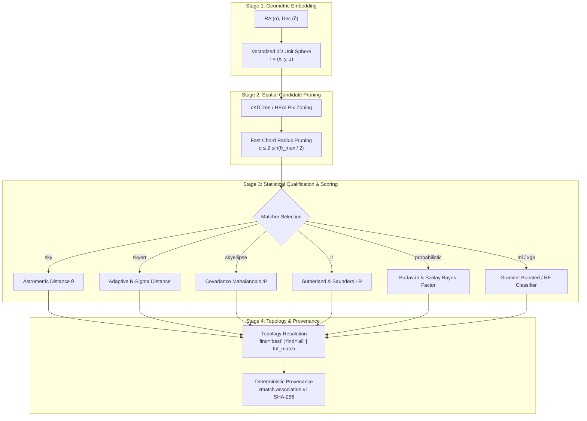
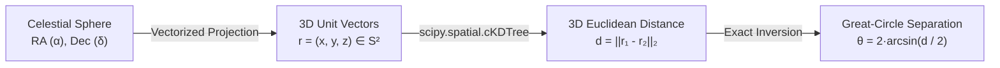
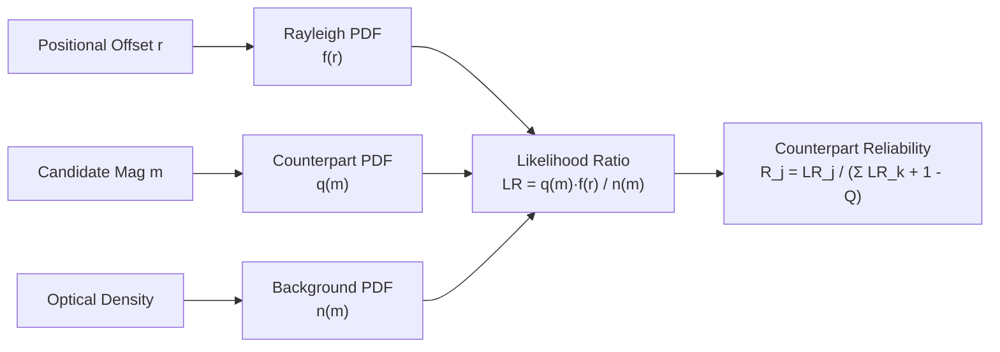
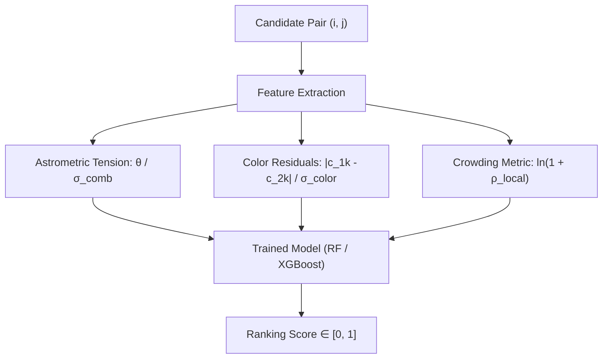
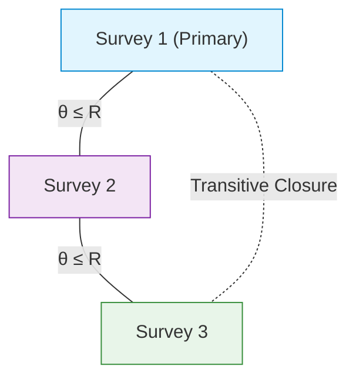
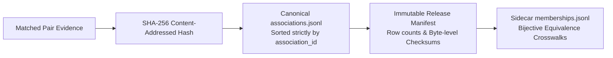

# Crossmatch Algorithms & Mathematical Foundations

A comprehensive guide to the astrometric, statistical, and machine-learning algorithms implemented in `xmatcher`.

---

## 1. Introduction & Architecture

### The Astronomical Challenge

Crossmatching astronomical catalogues is fundamentally different from a relational database `JOIN`. In astronomy:

- **Spherical Geometry**: Sources lie on the two-dimensional celestial sphere where Euclidean coordinate arithmetic does not apply.
- **Astrometric Uncertainties**: Every detection has measurement errors—ranging from sub-milliarcsecond precision in space astrometry (Gaia) to arcsecond uncertainties in ground-based seeing or radio interferometry.
- **Proper Motions & Kinematics**: Stars move over time. Decade-long baselines between surveys shift positions by arcseconds.
- **Disparate Resolutions & Bandpasses**: An optical source ($0.5''$ PSF) might correspond to an extended radio lobe ($5''$ beam) or a blended infrared centroid (WISE $6''$).
- **Crowded Fields & Blending**: In dense regions (Galactic bulge, globular clusters, Magellanic clouds), the chance of random spatial alignment approaches unity.

`xmatcher` solves these challenges through a modular, four-stage pipeline designed for both desktop laptops and multi-node distributed Ray clusters.

### The 4-Stage Processing Pipeline



---

## 2. Algorithm Capabilities & Selection Guide

Choose the appropriate matcher based on your input catalogue properties and scientific goals:

| Matcher Flag | Primary Inputs | Scoring Metric | Computational Complexity | Recommended Scientific Use Case |
|---|---|---|---|---|
| `matcher="sky"` | RA, Dec | Great-circle separation $\theta$ | $O(N \log M)$ | Fast spatial aperture matching with uniform search radius. |
| `matcher="skyerr"` | RA, Dec, $\sigma_{\text{pos}}$ | Normalised separation $\frac{\theta}{\sigma_1 + \sigma_2}$ | $O(N \log M)$ | Surveys with widely varying positional errors (e.g. Gaia vs. ground-based). |
| `matcher="skyellipse"` | RA, Dec, Covariance $\mathbf{C}$ | Mahalanobis distance $d_{\text{M}}^2$ | $O(N \log M + K)$ | Anisotropic errors (drift-scans, slitless spectroscopy, Chandra/XMM). |
| `matcher="lr"` | RA, Dec, $\sigma_{\text{pos}}$, Magnitude | Likelihood Ratio $LR$ and Reliability $R_j$ | $O(N \log M + K)$ | Cross-identifying low-resolution (Radio/X-ray) with dense Optical/IR catalogues. |
| `probabilistic=True` | RA, Dec, Errors, Photometry | Bayesian posterior $p_{\text{match}}$ | $O(N \log M + K)$ | Rigorous hypothesis testing ($H_{\text{match}}$ vs. $H_{\text{bg}}$) with empirical flux priors. |
| `nway_match()` | RA, Dec, Errors ($N \ge 2$) | Joint $N$-way Bayes factor $B$ | $O(N \cdot K_{\text{tuple}})$ | Simultaneous multi-survey matching (Budavári & Szalay 2008). |
| `matcher="ml"` | RA, Dec, Photometry/Colors | Random Forest pseudo-label score | $O(N \log M + K_{\text{infer}})$ | Multi-band optical/infrared matching with complex color distributions. |
| `matcher="xgb"` | RA, Dec, Photometry/Colors | Gradient Boosted tree score | $O(N \log M + K_{\text{infer}})$ | Non-linear photometric feature interactions and fast C++ inference. |
| `matcher="auf"` | RA, Dec | Empirical Annular Residual Score | $O(N \log M + K)$ | Heuristic background-subtracted candidate scoring. |
| `matcher="macauff"` | RA, Dec, Magnitudes | Multi-band Magnitude Odds Ratio | $O(N \log M + K)$ | Heuristic joint positional and photometric candidate re-weighting. |
| `fof_match()` | RA, Dec ($N \ge 2$) | Graph Connected Component | $O(V + E)$ | Grouping blended sources, galaxy cluster members, or multi-catalogue bundles. |

> [!NOTE]
> In the table above, $N$ and $M$ denote row counts of the primary and secondary catalogues, $K$ is the number of spatial candidate pairs within the bounding radius, and $E$ is the number of graph edges.

---

## 3. Geometric Foundation: 3D Unit-Sphere Embedding

Spherical trigonometry on individual celestial coordinates $(\alpha, \delta)$ requires expensive trigonometric evaluations ($\cos$, $\sin$, $\arccos$) for every candidate pair. `xmatcher`'s `engine="fast"` bypasses spherical trigonometry by vectorizing coordinates onto the 3D Cartesian unit sphere.



### Mathematical Formulation

Given Right Ascension $\alpha$ and Declination $\delta$ in radians, the 3D unit vector $\mathbf{r} = (x, y, z)^T \in \mathbb{R}^3$ on the unit sphere $\mathbb{S}^2$ is:

$$
x = \cos(\delta)\cos(\alpha), \qquad y = \cos(\delta)\sin(\alpha), \qquad z = \sin(\delta)
$$

The 3D Euclidean chord distance $d = \|\mathbf{r}_1 - \mathbf{r}_2\|_2$ between two points on the unit sphere relates directly to their great-circle angular separation $\theta$ via an isosceles triangle:

$$
d = 2 \sin\left(\frac{\theta}{2}\right)
$$

The exact angular separation is recovered via the inverse mapping:

$$
\theta = 2 \arcsin\left(\frac{d}{2}\right)
$$

### Small-Angle Approximation & Zero False Negatives

For small separations ($\theta \ll 1\text{ rad}$), the Taylor series expansion yields:

$$
d = \theta \left(1 - \frac{\theta^2}{24} + \mathcal{O}(\theta^4)\right)
$$

At an astronomical search radius of $\theta = 2'' \approx 9.7 \times 10^{-6}\text{ rad}$, the relative difference between chord distance $d$ and arc distance $\theta$ is less than $4 \times 10^{-12}$.

> [!IMPORTANT]
> To guarantee **zero false negatives**, `xmatcher` computes the exact chord search radius:
>
> $$
> d_{\text{search}} = 2 \sin\left(\frac{\theta_{\text{radius}}}{2}\right)
> $$
>
> The C++ `cKDTree` retrieves all points satisfying $\|\mathbf{r}_1 - \mathbf{r}_2\|_2 \le d_{\text{search}}$, and `xmatcher` converts the exact chord lengths back to great-circle arcseconds.

### Multimodal $N$-Dimensional Ranking

When non-spatial columns are supplied via `extra_distance_cols={"phot_g_mean_mag": 0.5}`, `xmatcher` queries spatial candidates with `cKDTree`, then ranks candidates using an $N$-dimensional Euclidean metric:

$$
D_{\text{total}}^2 = \left(\frac{\theta}{\theta_{\text{radius}}}\right)^2 + \sum_{k} w_k \left(\frac{c_{1, k} - c_{2, k}}{\sigma_{c, k}}\right)^2
$$

where $w_k$ is the user-specified column weight and $\sigma_{c, k}$ is the population standard deviation of that property.

---

## 4. Astrometric & Distance Matchers

### A. Simple Positional Matching (`matcher="sky"`)

#### Intuition
Finds all candidate pairs within a fixed angular search aperture $\theta_{\text{radius}}$. Suitable when positional uncertainties are uniform or small compared to the search radius.

#### Invocation
```python
spec = MatchSpec(radius_arcsec=1.5, matcher="sky", find="best")
df = cm.crossmatch("optical.parquet", "infrared.csv", spec=spec)
```

```bash
xmatcher match optical.parquet infrared.csv -r 1.5 -o matched.parquet
```

#### Mathematical Formulation
A candidate pair $(i, j)$ is admitted if the great-circle separation $\theta$ satisfies:

$$
\theta(i, j) \le \theta_{\text{radius}}
$$

For `find="best"`, the counterpart is the nearest neighbor:

$$
j^* = \arg\min_{j} \theta(i, j)
$$

For `find="all"`, all candidates within the aperture are retained.

---

### B. Sigma-Adaptive Matching (`matcher="skyerr"`)

#### Intuition
Fixed apertures penalize high-precision sources while admitting false positives for uncertain sources. The sigma-adaptive matcher scales the search radius per pair using the measured positional errors of both catalogues.

#### Invocation
```python
spec = MatchSpec(radius_arcsec=3.0, matcher="skyerr", max_error=3.0, find="best")
df = cm.crossmatch("gaia.parquet", "survey.csv", spec=spec)
```

```bash
xmatcher match gaia.parquet survey.csv --matcher skyerr --max-error 3.0 -r 3.0
```

#### Mathematical Formulation
Each catalogue's 1D radial positional uncertainty is computed from Right Ascension and Declination errors:

$$
\sigma_1 = \sqrt{\sigma_{\alpha*, 1}^2 + \sigma_{\delta, 1}^2}, \qquad \sigma_2 = \sqrt{\sigma_{\alpha*, 2}^2 + \sigma_{\delta, 2}^2}
$$

where $\sigma_{\alpha*} \equiv \sigma_\alpha \cos\delta$. The pair uncertainty is the sum of both errors:

$$
\sigma_{\text{pair}} = \sigma_1 + \sigma_2
$$

A candidate pair is admitted if it satisfies both the statistical threshold and the bounding search radius:

$$
\theta \le \min\left(\theta_{\text{radius}}, \, N_\sigma \cdot \sigma_{\text{pair}}\right)
$$

For `find="best"`, candidates are ranked by their normalized separation tension:

$$
\text{rank} = \frac{\theta}{\sigma_{\text{pair}}}
$$

> [!CAUTION]
> **Corrupted Error Protection**: The user's `radius_arcsec` acts as a strict ceiling. If a catalogue contains corrupt or unbounded error values (e.g. Pan-STARRS1 DR1 contains rows with `e_RAJ2000` exceeding hundreds of arcseconds), `xmatcher` ensures candidates outside the physical search aperture are never accepted.

---

### C. Sky Ellipse & Mahalanobis Distance (`matcher="skyellipse"`)

#### Intuition
In many astronomical instruments (slitless grisms, high-airmass atmospheric dispersion, radio interferometry, or Chandra off-axis PSFs), astrometric uncertainties are strongly anisotropic. The `skyellipse` matcher evaluates the full 2D error covariance matrix via the Mahalanobis distance.

#### Invocation
```python
spec = MatchSpec(radius_arcsec=3.0, matcher="skyellipse", max_error=3.0)
df = cm.crossmatch("chandra.fits", "vla.parquet", spec=spec)
```

#### Mathematical Formulation
Coordinates are projected onto the local tangent plane at the pair's mean declination $\bar{\delta} = \frac{\delta_1 + \delta_2}{2}$:

$$
\Delta \mathbf{r} = \begin{pmatrix} \Delta x \\ \Delta y \end{pmatrix} = \begin{pmatrix} (\alpha_1 - \alpha_2)\cos\bar{\delta} \\ \delta_1 - \delta_2 \end{pmatrix}
$$

Each catalogue provides an astrometric covariance matrix $\mathbf{C}_i$ with cross-correlation coefficient $\rho_i \in [-1, 1]$:

$$
\mathbf{C}_i = \begin{pmatrix} \sigma_{\alpha*, i}^2 & \rho_i \sigma_{\alpha*, i} \sigma_{\delta, i} \\ \rho_i \sigma_{\alpha*, i} \sigma_{\delta, i} & \sigma_{\delta, i}^2 \end{pmatrix}
$$

The joint covariance matrix of the difference vector $\Delta \mathbf{r}$ is:

$$
\mathbf{C}_{\text{joint}} = \mathbf{C}_1 + \mathbf{C}_2 = \begin{pmatrix} C_{11} & C_{12} \\ C_{12} & C_{22} \end{pmatrix}
$$

The squared Mahalanobis distance $d_{\text{M}}^2$ evaluates the positional tension in units of joint covariance:

$$
d_{\text{M}}^2 = \Delta \mathbf{r}^T \mathbf{C}_{\text{joint}}^{-1} \Delta \mathbf{r}
$$

Using the closed-form $2 \times 2$ inverse:

$$
d_{\text{M}}^2 = \frac{C_{22} \Delta x^2 - 2 C_{12} \Delta x \Delta y + C_{11} \Delta y^2}{C_{11} C_{22} - C_{12}^2}
$$

A candidate pair is admitted if:

$$
d_{\text{M}}^2 \le N_\sigma^2
$$

#### Algorithmic Procedure
1. **Candidate Query**: Query $k$ spatial neighbors within a conservative chord distance derived from the maximum possible semi-major axis $\sqrt{\lambda_{\max}(\mathbf{C}_{\text{joint}})}$.
2. **Tangent Projection**: Compute $\Delta \mathbf{r}$ in arcseconds.
3. **Metric Evaluation**: Evaluate $d_{\text{M}}^2$ in vectorized NumPy/Polars batches.
4. **Ranking & Filtering**: Drop pairs with $d_{\text{M}}^2 > N_\sigma^2$ and rank survivors by $d_{\text{M}}^2$.

---

## 5. Kinematics & Proper Motion Propagation

### A. Linear Epoch Propagation (`target_epoch`)

When crossmatching catalogues observed at different epochs (e.g. USNO-B1.0 at 1975 vs. Gaia DR3 at 2016.0), proper motions shift stellar coordinates across the sky.

Given reference epoch $t_0$, target epoch $t$, and proper motions $(\mu_{\alpha*}, \mu_\delta)$ in $\text{mas/yr}$:

$$
\alpha(t) = \alpha(t_0) + \frac{\mu_{\alpha*}}{\cos\delta} \left(\frac{t - t_0}{1000 \times 3600}\right)
$$

$$
\delta(t) = \delta(t_0) + \mu_\delta \left(\frac{t - t_0}{1000 \times 3600}\right)
$$

The positional covariance matrix is transported forward in time, accounting for the uncertainty in proper motion $\mathbf{\Sigma}_\mu$:

$$
\mathbf{C}(t) = \mathbf{C}(t_0) + (\Delta t)^2 \mathbf{\Sigma}_\mu
$$

where $\Delta t = t - t_0$ is the epoch baseline in years.

---

### B. Assumed Kinematic Drift Prior (`pm_prior=True`, Wilson 2023)

#### Intuition
Faint stars often lack measured proper motions. When matching historical plates or deep imaging against modern surveys across multi-decade baselines, assuming zero proper motion produces false rejections. The Wilson (2023)-inspired drift model adds an assumed kinematic dispersion budget based on Galactic latitude.

#### Mathematical Formulation
Stellar velocity dispersions increase toward the Galactic plane. The assumed 1D proper motion dispersion $\sigma_\mu(b)$ as a function of Galactic latitude $b$ is:

$$
\sigma_\mu(b) = 3 + 7 \exp\left(-\frac{|b|}{20^\circ}\right) \quad [\text{mas/yr}]
$$

The resulting positional drift uncertainty across epoch difference $\Delta t$ is:

$$
\sigma_{\text{drift}} = \sigma_\mu(b) \cdot \frac{|\Delta t|}{1000} \cdot S(m) \quad [\text{arcsec}]
$$

where $S(m)$ is an optional magnitude-distance proxy scaling:

$$
S(m) = \operatorname{clip}\left(10^{-0.2(m - 15)}, \, 0.3, \, 3.0\right)
$$

The drift uncertainty is added isotropically in quadrature to each tangent-plane axis:

$$
\sigma_{\text{axis, total}}^2 = \sigma_{\text{axis, astrometric}}^2 + \frac{1}{2} \sigma_{\text{drift}}^2
$$

---

## 6. Probabilistic & Bayesian Matchers

### A. Sutherland & Saunders (1992) Likelihood Ratio (`matcher="lr"`)

#### Intuition
Designed for cross-identifying catalogues with disparate spatial resolutions—such as matching a low-resolution Radio or X-ray survey against a dense optical catalogue. Spatial proximity alone is insufficient because bright optical counterparts are physically preferred over faint background contaminants near the beam center.



#### Mathematical Formulation
The Likelihood Ratio $LR$ of candidate $j$ at separation $r$ with magnitude $m$ is defined as:

$$
LR = \frac{q(m) \, f(r)}{n(m)}
$$

where:

**Radial Positional Probability Density $f(r)$**:
Modeled as a 2D circularly symmetric Gaussian on the tangent plane:

$$
f(r) = \frac{r}{\sigma_{\text{pos}}^2} \exp\left(-\frac{r^2}{2\sigma_{\text{pos}}^2}\right)
$$

**Background Surface Density $n(m)$**:
Surface density of background objects per square arcsecond per magnitude bin:

$$
n(m) = \frac{N_{\text{bg}}(m)}{\text{Area}_{\text{survey}}}
$$

**Counterpart Magnitude Distribution $q(m)$**:
Probability distribution of true counterparts possessing magnitude $m$, estimated empirically by subtracting the expected background counts from observed candidate counts:

$$
q(m) = \frac{\max\left(0, \, N_{\text{cand}}(m) - \pi R^2 N_{\text{prim}} n(m)\right)}{\sum_{m'} \max\left(0, \, N_{\text{cand}}(m') - \pi R^2 N_{\text{prim}} n(m')\right)}
$$

#### Counterpart Reliability
When multiple candidates fall within the search aperture, the reliability $R_j$ of candidate $j$ is:

$$
R_j = \frac{LR_j}{\sum_{k} LR_k + (1 - Q)}
$$

where $Q \in (0, 1]$ is the prior probability that a primary source possesses an observable counterpart above the detection limit (default: $Q = 0.8$).

---

### B. Bayesian Pairwise Probabilistic Qualifier (`probabilistic=True`)

#### Intuition
Evaluates the posterior probability that two detections represent the same physical entity by comparing the match hypothesis $H_{\text{match}}$ against the background chance-alignment hypothesis $H_{\text{bg}}$ inside search disc $\Omega = \pi R^2$.

#### Mathematical Formulation

##### 1. Positional Likelihoods
The match hypothesis models separation under joint isotropic Gaussian uncertainty $\sigma_{\text{eff}}^2 = \sigma_1^2 + \sigma_2^2$:

$$
p(\Delta \mathbf{r} \mid H_{\text{match}}) = \frac{1}{2\pi \sigma_{\text{eff}}^2} \exp\left(-\frac{\theta^2}{2\sigma_{\text{eff}}^2}\right)
$$

The background hypothesis models a uniform spatial distribution across the search aperture:

$$
p(\Delta \mathbf{r} \mid H_{\text{bg}}) = \frac{1}{\pi R^2}
$$

##### 2. Empirical Photometric KDE Priors
When `prior_columns` are provided, empirical Kernel Density Estimators (KDE) are fit on an unconditional sample of the survey union (up to 50,000 sources).
- Under $H_{\text{match}}$, both measurements stem from the same source; the KDE is evaluated at their midpoint $\bar{m} = \frac{m_1 + m_2}{2}$.
- Under $H_{\text{bg}}$, the two measurements are independent draws from the background population.

The combined log-likelihoods are:

$$
\mathcal{L}_{\text{match}} = \ln p(\Delta \mathbf{r} \mid H_{\text{match}}) + \sum_{k} \ln \text{KDE}_k\left(\frac{m_{1, k} + m_{2, k}}{2}\right)
$$

$$
\mathcal{L}_{\text{bg}} = \ln p(\Delta \mathbf{r} \mid H_{\text{bg}}) + \sum_{k} \left[\ln \text{KDE}_k(m_{1, k}) + \ln \text{KDE}_k(m_{2, k})\right]
$$

##### 3. Numerically Stable Posterior Probability
Using equal prior odds ($P(H_{\text{match}}) = P(H_{\text{bg}}) = 0.5$):

$$
p_{\text{match}} = \frac{1}{1 + \exp\left(-\left(\mathcal{L}_{\text{match}} - \mathcal{L}_{\text{bg}}\right)\right)}
$$

---

### C. Simultaneous $N$-Way Bayesian Matching (`nway_match`)

#### Intuition
Chaining sequential pairwise matches ($A \times B \times C$) leads to accumulated false associations and depends on catalogue order. The $N$-way matcher implements the Budavári & Szalay (2008) formulation to jointly evaluate the mutual astrometric agreement of $N \ge 2$ catalogues simultaneously.

#### Mathematical Formulation
Let $N$ catalogues report coordinates $\mathbf{x}_i$ with isotropic per-axis uncertainties $\sigma_i$ (in radians). Define the astrometric precision weights:

$$
w_i = \frac{1}{\sigma_i^2}, \qquad W = \sum_{i=1}^N w_i
$$

The simultaneous spatial Bayes factor $B$ is:

$$
B = 2^{N-1} \frac{\prod_{i=1}^N w_i}{W} \exp\left(-\frac{1}{2} \sum_{i < j} \frac{w_i w_j}{W} \psi_{ij}^2\right)
$$

where $\psi_{ij}$ is the great-circle separation between catalogue $i$ and catalogue $j$ in radians.

#### Breakdown of Terms
- **Precision Concentration Factor**: The prefactor $2^{N-1} \frac{\prod w_i}{W}$ represents the volume compression of the joint parameter space under the match hypothesis.
- **Pairwise Astrometric Tension Penalty**: The exponential term $\sum_{i<j} \frac{w_i w_j}{W} \psi_{ij}^2$ penalizes mutual coordinate divergence across all catalogue pairs simultaneously.

#### Posterior Probability
Applying prior probability $P_0$ (default: $0.5$):

$$
p_{\text{match}} = \frac{1}{1 + \exp\left(-\left(\ln B + \ln \frac{P_0}{1 - P_0}\right)\right)}
$$

---

## 7. Machine Learning Matchers (`matcher="ml"`, `matcher="xgb"`)

### Intuition
When multi-band photometry, colors, and local stellar density provide rich discriminative information, ML classifiers learn non-linear decision boundaries between true counterparts and chance background alignments.



### Feature Engineering
For each candidate pair $(i, j)$, features are computed in vectorized batches:

**1. Normalized Separation**:

$$
\chi_{\text{sep}} = \frac{\theta}{\sqrt{\sigma_1^2 + \sigma_2^2}}
$$

**2. Normalized Photometric Color Differences**:
For each user-specified color column $k$:

$$
\Delta c_k = \frac{|m_{1, k} - m_{2, k}|}{\sigma_{c, k}}
$$

**3. Local Surface Density**:
Local source density $\rho_{\text{local}}$ is computed via $k$-nearest neighbor distance $d_k$:

$$
\rho_{\text{local}} = \frac{k}{\pi d_k^2}, \qquad \text{Feature} = \ln\left(1 + \rho_{\text{local}}\right)
$$

### Training Procedure
- **Positive Labels ($y = 1$)**: Drawn from high-confidence, tight-aperture nearest-neighbor pairs ($\theta < 0.3''$).
- **Negative Labels ($y = 0$)**: Synthesized by pairing primary sources with random distant sources ($2'' < \theta < 10''$).
- **Models**:
  - `matcher="ml"`: Scikit-learn `RandomForestClassifier`.
  - `matcher="xgb"`: XGBoost / LightGBM gradient boosted decision trees.
- **Model Persistence**: Serialized via `joblib` (`--ml-model-path` / `--xgb-model-path`) for reuse across massive batches without retraining overhead.

---

## 8. Graph Clustering: Friends-of-Friends (`fof_match`)

### Intuition
In complex environments or multi-catalogue merges, pairwise matches form interconnected graphs. Friends-of-Friends computes the transitive closure: if source $A$ matches $B$, and $B$ matches $C$, all three are grouped into an object bundle.



### Algorithmic Procedure
1. **Edge Formation**: Construct an undirected graph $G = (V, E)$ where vertices $V$ are sources and edges $E$ connect any pair with $\theta \le \theta_{\text{radius}}$.
2. **Disjoint-Set Union-Find**:
   - Compute connected components using disjoint-set forests with **path compression** and **union by rank**.
   - Amortized complexity is nearly linear: $O(|V| \cdot \alpha(|V|))$, where $\alpha$ is the inverse Ackermann function.
3. **Bundle Aggregation**:
   - Assign a persistent `bundle_id` to each connected component.
   - Retain components containing at least one source from the primary catalogue.
   - Aggregate numerical attributes by mean and categorical attributes by priority order.

---

## 9. Provenance Identity: Deterministic Association (`xmatch.association.v1`)

A fundamental hazard in astronomical data engineering is the conflation of **ephemeral graph components** with **permanent celestial object identities**. As new survey releases are incorporated, candidate graphs split, merge, and drift.

`xmatcher` implements the `xmatch.association.v1` normative contract to guarantee reproducible, content-addressed identity across data releases (see [Association Contract v1](association-v1.md)).



### Mathematical Formulation
The `association_id` is a 64-character hexadecimal SHA-256 digest computed deterministically over normalized record fields:

$$
\text{association\_id} = \text{SHA-256}\left(\text{evidence\_id} \,\|\, \text{source\_id} \,\|\, \text{candidate\_id} \,\|\, t_{\text{eval}} \,\|\, \text{release\_ids} \,\|\, \text{params}\right)
$$

### Integrity Guarantees
- **Byte-Level Checksums**: Manifest files record row counts and SHA-256 digests of all association and membership files.
- **Fail-Closed Validation**: Any file modification, missing record, or ordering violation fails with an immediate error.
- **Bijective Crosswalks**: Tracks object splits and merges between data releases without relying on mutable string identifiers.

---

## 10. Astronomer's Observational Reality & Systematics

Real-world astronomical data contains physical systematics that must be considered when evaluating matches:

### 1. Non-Gaussian Astrometric Error Tails
Classical matchers assume Gaussian astrometric noise. In ground-based imaging, atmospheric turbulence, blended diffraction spikes, and unmodeled telescope jitter introduce power-law wings.
> [!TIP]
> When matching ground-based surveys, configure a conservative `radius_arcsec` bound alongside `skyerr` to prevent outliers with underestimated errors from escaping candidate selection.

### 2. Differential Chromatic Refraction (DCR)
Atmospheric refraction bends blue light more strongly than red light. At high airmass ($z > 45^\circ$), centroids between $u$-band and $z$-band observations of the exact same star can shift by up to $0.1'' - 0.3''$.
> [!NOTE]
> When crossmatching blue-sensitive surveys (e.g. GALEX, SDSS $u$) against red/infrared surveys (e.g. WISE, 2MASS), ensure search radii are not narrower than the expected chromatic dispersion.

### 3. Crowded Fields & Blending Limits
In dense fields (stellar surface density $\rho$), the probability of finding at least one unrelated background object within search radius $R$ is given by the Poisson distribution:

$$
P(\ge 1 \text{ false match}) = 1 - \exp\left(-\pi R^2 \rho\right)
$$

When $\pi R^2 \rho \approx 1$, spatial proximity alone fails completely.
> [!IMPORTANT]
> In crowded fields, do not rely on `find="best"` spatial distance alone. Use `extra_distance_cols`, `matcher="lr"`, or `matcher="xgb"` to incorporate multi-band flux and color priors.

### 4. Semantic Score Interpretation Guide

| Score Column | Scale | Meaning & Validity |
|---|---|---|
| `sep_arcsec` | $[0, \infty)$ | True great-circle angular distance on the celestial sphere. |
| `rank` (`skyerr`) | $[0, \infty)$ | Positional tension normalized by combined $1\sigma$ uncertainty. |
| `d2_mahalanobis` | $[0, \infty)$ | Covariance-weighted squared distance; distributed as $\chi^2$ with 2 d.o.f. |
| `lr` | $[0, \infty)$ | Sutherland & Saunders Likelihood Ratio. Higher values indicate greater match odds. |
| `reliability` | $[0, 1]$ | Candidate reliability under explicit model distribution estimates. |
| `p_match` | $[0, 1]$ | Bayesian posterior probability under declared equal prior odds and uniform background. |
| `ml_score` / `xgb_score` | $[0, 1]$ | Supervised classifier ranking score. Excellent for ordering; not calibrated probabilities. |
