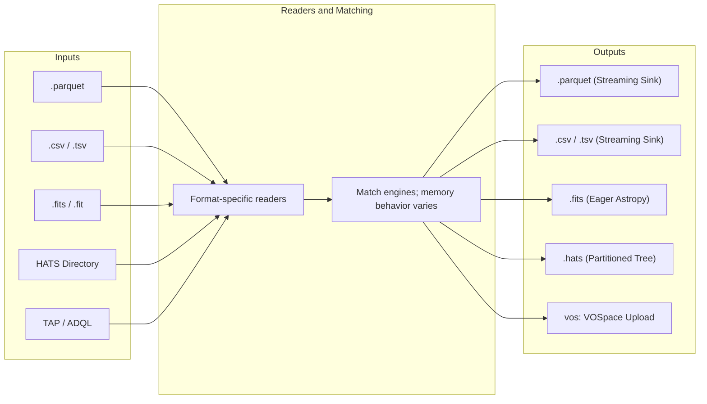

# xmatcher user guide

Workflows for astronomical catalogue crossmatching with `xmatcher`: formats,
remote archives, local mirrors, matchers, joins and execution paths.
Install the package first ([install.md](install.md)); for a first run see the
[README quickstart](../README.md#quickstart). Reference material lives in the
[CLI Reference](cli.md), [Python API Reference](api.md) and
[Algorithms & Mathematics](algorithms.md).

---

## 1. Formats & storage

`xmatcher` reads Parquet and CSV lazily through Polars and FITS through
torchfits. Output can be written by a streaming sink, but the local match
engines collect coordinates and candidate pairs in memory; see
[§6](#6-choosing-an-execution-path) for the paths that bound memory.



### Supported formats for `xmatcher match`

| Format | Extension | Read | Write | Memory |
|---|---|---|---|---|
| **Parquet** | `.parquet` | `pl.scan_parquet` | Polars streaming sink | Scan and output can stream; matching materializes coordinates and pairs |
| **CSV** | `.csv` | `pl.scan_csv` | Polars streaming sink | As Parquet |
| **TSV / Tab** | `.tsv`, `.tab` | `pl.scan_csv(separator="\t")` | Polars sink | As Parquet |
| **FITS** | `.fits`, `.fit` | torchfits, with an Astropy fallback for masked or unsupported tables | `polars_to_astropy().write()` | Eager |
| **HATS** | directory | Native HATS pixel reader | `write_hats()` / `ray_union` | Partitioned input; matching memory depends on engine and path |
| **VOSpace** | `vos:*` | Staged locally (`storage.py`) | Written locally, then uploaded to the VOSpace node | As the local format |
| **S3 (HATS)** | `s3://bucket/prefix` | Anonymous HTTPS listing/GET (`s3.py`) into the local mirror | Not a write target | Streamed transfer |
| **Hugging Face (HATS)** | `hf://datasets/owner/name` | Hub tree API listing + `/resolve` download (`hf.py`) into the local mirror | Not a write target | Streamed transfer |

A remote HATS tree (HTTP(S), `vos:`, `s3://`, `hf://`) is matched from its
local mirror: run `xmatcher sync` first ([§3](#3-local-mirroring--offline-caching-xmatcher-sync)),
or use `engine="ray-union"` / `engine="ray-anchor"`, which mirror their inputs
on demand. Writing a `.hats` match output, and mirroring a TAP catalogue to
HATS, need the optional `cdshealpix` package
([install.md](install.md#optional-extras)).

### Lazy results and output files

```python
import polars as pl

from xmatcher import CrossMatch

cm = CrossMatch()

# Write the result through the output sink; returns None.
# The sink streams, but the match itself still runs in memory.
cm.crossmatch(
    "catalog_a.parquet",
    "reference_survey.parquet",
    output_file="out.parquet",
)

# lazy=True returns a LazyFrame over the result for further Polars queries.
# The match has already run when the call returns.
lazy_result = cm.crossmatch(
    "catalog_a.parquet",
    "catalog_b.csv",
    lazy=True,
)

filtered = (
    lazy_result.filter(pl.col("sep_arcsec") < 0.5)
    .select(["ra", "dec", "phot_g_mean_mag"])
    .collect()
)
```

Every positional result carries a great-circle `sep_arcsec` column. Columns of
the second catalogue that collide with the first take a `_2` suffix.

### Converting and flattening catalogues

`xmatcher convert <source> <output>` converts between FITS, Parquet, HATS and
CSV in any direction; the output suffix names the format. Rows stream in Arrow
batches (`--batch-rows`, default 262,144), so memory stays bounded. FITS is
written by a streaming binary-table writer rather than Astropy; a HATS output
takes three passes over the input (count, tile, write), with the tiling set by
`--hats-max-rows` and `--hats-max-order`. Reading a HATS tree drops its
`_healpix_29` index column unless `--keep-healpix29` is given.

```bash
xmatcher convert gaia_field.fits gaia_field.hats
xmatcher convert survey.parquet survey.hats --ra-col RA_ICRS --dec-col DE_ICRS
xmatcher convert gaia_field.hats gaia_field.parquet --columns source_id,ra,dec
xmatcher convert survey.hats survey.fits --overwrite
```

To hand a HATS tree to tools that read only ordinary tables, flatten it with
`xmatcher export-hats <source> <out.parquet|out.fits>` (Python:
`xmatcher.export_hats`, or `xmatcher.scan_hats` for a lazy Polars scan).
Parquet export scans the Npix partitions lazily; FITS export goes through the
`convert` writer in one bounded-memory pass. `_healpix_29` is dropped unless
`--keep-healpix29` is given. A flat file of a survey-scale tree is still
large; keep the HATS layout when a single file is not required.

---

## 2. Remote archives & discovery

`xmatcher` ships catalogue and endpoint configurations for several TAP
services. Availability, access policy, table schemas and service limits change;
check them with `xmatcher search` / `xmatcher describe` before large queries.

### Catalogue identifiers

Every catalogue position accepts a local file or HATS directory, a configured
name or alias (`gaia`, `ps1`; `xmatcher list --aliases` prints them all), or an
explicit identifier: `vizier:<id>` (`vizier:II/349/ps1`),
`tap:<endpoint>/<table>` (`tap:noirlab/nsc_dr2.object`) or `hats:<url-or-name>`
(`hats:two_mass`, `hats:s3://stpubdata/gaia/gaia_dr3/public/hats`). Explicit
prefixes are checked first and configured names before the filesystem, so a
local file named like a catalogue needs a path prefix (`./gaia`).
[naming.md](naming.md) gives the full resolution order and naming grammar;
[hats-sources.md](hats-sources.md) covers `hats:` lookups.

### Matching against a remote TAP catalogue

When one input is local and the other is a remote TAP or CDS catalogue,
`xmatcher` computes a cone enclosing the local catalogue (its sky extent plus
the match radius), downloads the remote rows in that cone, and matches
locally. If the remote catalogue has been mirrored with `xmatcher sync` and the
mirror holds every requested column, the cone is read from the mirror instead.

```bash
# Gaia DR3 within the footprint of my_sources.csv
xmatcher match my_sources.csv gaia -r 1.0 -o matches.parquet

# Explicit cone: 0.05 deg around Vega
xmatcher match gaia my_catalog.csv --ra 279.23 --dec 38.78 --radius-deg 0.05 -r 1.5
```

Two server-side routes skip the download: a local-vs-CDS match uses the CDS
XMatch service, and two remote tables on the same TAP endpoint are joined
there. Both apply only to `matcher="sky"`, `find="all"`, inner joins
(`1and2`), automatic engine selection, and no explicit region, ID join,
post-filter, N-D feature, column projection, target epoch or
probabilistic/photometric scoring. Other requests download a region and match
locally.

Explicit `ra`, `dec` and `radius_deg` (`--ra`, `--dec`, `--radius-deg`) are
required when:

- both inputs are remote and the server-side join does not apply (there is no
  local catalogue to derive a region from);
- the request uses `skyerr`, `skyellipse` or `target_epoch` with a remote
  input, even when the other input is local: the remote catalogue's
  uncertainty or motion halo is not known in advance, so no safe region can be
  derived. Choose a cone that covers the match area plus that margin.

### Pre-computed crossmatch tables

NOIRLab Data Lab publishes pre-computed 1.5″ nearest-neighbour crossmatch
tables, configured as `nsc_x_gaia`, `des_x_gaia`, `decals_x_gaia`,
`allwise_x_gaia` and `ukidss_x_gaia`. Each row is one survey–Gaia pair
(`ra1`/`dec1`, `ra2`/`dec2`, `id1`, `id2`, `distance`). `xmatcher` treats such a
table as an ordinary TAP catalogue positioned at the survey coordinates
(`ra1`, `dec1`): matching your sources against it returns both the survey ID
and the Gaia `source_id` without downloading either full catalogue. The
products carry no per-pair errors; a 0.75″ default positional error is
configured.

```bash
xmatcher match nsc_x_gaia my_stars.csv --ra 279.2 --dec 38.8 --radius-deg 0.01 -r 1.5
```

### Discovering remote tables

```bash
# List configured catalogues (add --aliases for short-name mappings)
xmatcher list
xmatcher list --aliases

# List HATS catalogues registered in the IVOA registry (see hats-sources.md)
xmatcher list --hats

# Full metadata for one configured catalogue
xmatcher describe gaia

# Search every known TAP endpoint for table names containing a substring
xmatcher search rubin
xmatcher search unWISE

# Browse the tables of one endpoint (e.g. NOIRLab Data Lab)
xmatcher discover noirlab

# Column schema of one table, with a suggested YAML snippet
xmatcher discover noirlab --schema nsc_dr2.object

# Probe a table and append it to ~/.config/xmatcher/xmatcher.yaml
xmatcher adopt vizier II/349/ps1 --name ps1
```

`xmatcher adopt --dry-run` prints the YAML snippet without writing it.

---

## 3. Local mirroring & offline caching (`xmatcher sync`)

`xmatcher sync` mirrors remote catalogues into a durable HATS cache. The cache
root is `--cache-root`, else `$XMATCHER_CACHE_ROOT`, else
`/arc/projects/astroai/hats` on AstroAI/CANFAR sessions, else
`~/.cache/xmatcher`. On CANFAR, write match outputs under
`/arc/projects/astroai/xmatcher`. `/arc/projects/hats` is the community HATS
tree: xmatcher reads it and never writes to it.

### Community trees used in place

A catalogue whose HATS tree already sits in a read-only *community root* is
read there instead of being mirrored again. On AstroAI/CANFAR sessions the
community root defaults to `/arc/projects/hats`; set
`XMATCHER_COMMUNITY_ROOTS` (`:`-separated, empty to disable) or
`cache.community_roots` in `xmatcher.yaml` elsewhere. Two things find a copy:

- **Sync records.** A tree copied with xmatcher-style versioning carries a
  `PENSUS_SYNC.json` (or xmatcher's `sync.json`) naming the upstream URL and
  version directory. When both match a remote HATS catalogue's
  `access_identifier`, that tree is used (on CANFAR, `twomass_hats` reads
  `/arc/projects/hats/2mass/psc` this way).
- **`local_paths`.** A catalogue entry can list equivalent copies without a
  sync record (`gaia_lsdb_hats` lists `/arc/projects/hats/gaia/dr3`).

The copy must have `properties` and a partition index, a complete sync record
when it has one, and the `hats_nrows` / `obs_collection` / coordinate columns
the entry pins. If it passes, it is read in place with the entry's metadata
(epoch, motion, error and id columns, `default_columns`); if not, the warning
names the reason and xmatcher falls back to the writable cache. `xmatcher sync`
reports such catalogues as served in place and downloads nothing. The index of
sync records is cached in `<cache>/registry/community_index.json` for a day
(`XMATCHER_COMMUNITY_INDEX_TTL` seconds), and a new survey or product
directory invalidates it early.

```yaml
cache:
  root: /arc/projects/astroai/hats      # writable primary
  replica_roots: [vos:projects/astroai/hats]  # written after each sync (`roots:` still works)
  community_roots: [/arc/projects/hats]  # read only: never synced, replicated or written
```

Nothing is ever written inside a community root, nor under
`/arc/projects/hats` whatever the configuration: a cache root, replica root,
registry snapshot, index or output directory there raises `ReadOnlyRootError`
before anything is created. The bundled configuration has entries for the
community trees with no other alias (`sdss_dr16_photoprimary`, `ps1_otmo`,
`vhs_dr7`, `ls_dr11_sweep`, `des_y6_gold`, ...); see
[HATS sources](hats-sources.md#community-trees-on-canfar).
`xmatcher adopt hats <path-or-url> --name NAME` drafts an entry for another
tree from its properties and schema.

```bash
# Mirror three configured catalogues
xmatcher sync gaia allwise twomass

# Re-sync: checks TAP page windows or advertised remote HATS partition sizes
xmatcher sync gaia

# Refetch everything, ignoring the incremental manifest
xmatcher sync gaia --force

# Mirror a catalogue the registry publishes only on S3 (anonymous read)
xmatcher sync hats:euclid_q1_ipac

# Mirror a catalogue the registry publishes on Hugging Face
xmatcher sync hats:mmu_cfa_seccsn
```

Other options: `--rate-limit` (requests per second per host, default 1.0; 0
disables throttling), `--threads` (parallel download workers, default 8),
`--fresh-after DAYS` (skip the change probe for copies fully synced within that
many days), and `--min-free-gb` (fail early when the cache filesystem has less
free space; default 10 GiB, or `XMATCHER_MIN_FREE_GB`).

What a mirror provides:

1. **Fewer remote queries.** Cone downloads for a mirrored TAP catalogue are
   served from the mirror when it holds every requested column, so repeated
   analyses avoid archive rate limits and outages.
2. **Partitioned local reads.** The mirror is a spatially partitioned HATS
   tree, so a cone reads only the partitions it overlaps.
3. **Distributed matching.** Mirrored HATS trees feed `engine="ray-union"` and
   `engine="ray-anchor"`; the cache path must be visible to the Ray workers.

TAP resume requires a stable, unique, non-null key. The page-window row-count
check does not detect edits that preserve a page's row count; use `--force`
after such changes or when expanding the page window. Append-only growth is
checked with a maximum-key probe. Remote HATS synchronization compares
advertised partition sizes with the mirror manifest; use `--force` to pick up
upstream edits that keep the same size.

`s3://` and `hf://` sources are read anonymously and always mirrored into the
local cache; see [hats-sources.md](hats-sources.md#s3-hosted-sources) for
access rules and the `XMATCHER_S3_ENDPOINT` / `XMATCHER_HF_ENDPOINT`
overrides.

---

## 4. Crossmatch algorithm cookbook

```python
from xmatcher import CrossMatch, MatchRequest, MatchSpec, SideOverrides

cm = CrossMatch()
```

`radius_arcsec` (CLI `-r`, default 1.0) is a hard ceiling on separation for
every matcher, including the error-scaled ones: `skyerr` and `skyellipse` can
only narrow it. Set it to the largest separation you are willing to accept.

### Per-catalogue column and error settings

Small local files rarely carry the column metadata that `skyerr`,
`skyellipse` and probabilistic scoring need. In Python, pass a
`SideOverrides` per side. On the CLI, the same keys go in repeatable
`--side1` / `--side2` comma-separated `KEY=VALUE` pairs, and `--side N KEY=VALUE`
addresses catalogue `N` of an N-way run:

```bash
xmatcher match xray.fits optical.parquet --matcher skyerr -r 5 \
  --side1 ra_err_column=ra_err,dec_err_column=dec_err,pos_err_units=arcsec \
  --side2 ra_err_column=e_RAJ2000,dec_err_column=e_DEJ2000,pos_err_units=arcsec
```

Accepted keys are `ra_column`, `dec_column`, `id_column`, `ra_err_column`,
`dec_err_column`, `corr_column`, `pos_err_units` (`arcsec`, `mas`, `arcmin` or
`deg`), `default_pos_error_arcsec`, `epoch`, `epoch_column`, `pm_ra_column`,
`pm_dec_column`, `parallax_column`, `radial_velocity_column`, `frame` and
`lr_magnitude_column`. They override YAML metadata and auto-detection for that
catalogue only. In the Python multi-catalogue methods (`crossmatch_multi`,
`union_match`, `fof_match`) the same keys are keyword arguments with a
catalogue suffix, e.g. `ra_err_column_3="e_ra"`.

### Fallback policy

If a requested matcher or engine cannot honour the request, the default
`--fallback-policy warn` (`MatchSpec(fallback_policy="warn")`) logs a warning
and substitutes a supported path. This can change the selection criterion:
for example, `skyerr` without positional errors on both sides falls back to a
fixed-radius `sky` match. Use `--fallback-policy error` for reproducible
science runs that must fail instead. Target-epoch `skyerr` without positional
errors is an error under either policy.

### A. Simple positional matching (`matcher="sky"`)

Fixed great-circle radius: $\text{sep} \le \theta_{\text{radius}}$.

```python
spec = MatchSpec(radius_arcsec=1.2, matcher="sky", find="best")
result = cm.crossmatch_request(MatchRequest(cat1="cat_a.parquet", cat2="cat_b.parquet", spec=spec))
```

`find="best"` keeps the nearest counterpart per row of the first catalogue
(ties go to the lowest row index of the second); `find="all"` keeps every pair
within the radius.

### B. Per-row error radius (`matcher="skyerr"`)

A pair is accepted when its separation is within `max_error` (default 3)
times the sum of the two rows' radial errors, and within `radius_arcsec`.
`find="best"` ranks by separation over that limit. Formulas and error sources:
[algorithms §4B](algorithms.md#b-sigma-adaptive-matching-matcherskyerr).

```python
# Supply per-side columns/units, or configure equivalent metadata in xmatcher.yaml.
spec = MatchSpec(radius_arcsec=2.0, matcher="skyerr", max_error=3.0, find="best")
req = MatchRequest(
    cat1="gaia_dr3.parquet",
    cat2="hst_sources.csv",
    spec=spec,
    side1=SideOverrides(ra_err_column="ra_error", dec_err_column="dec_error", pos_err_units="mas"),
    side2=SideOverrides(
        ra_err_column="ra_error", dec_err_column="dec_error", pos_err_units="arcsec"
    ),
)
result = cm.crossmatch_request(req)
```

### C. Error ellipses (`matcher="skyellipse"`)

Uses each row's full 2-D positional covariance (with a declared RA/Dec
correlation column) and accepts a pair when its Mahalanobis distance is at most
`max_error` and its separation within `radius_arcsec`; see
[algorithms §4C](algorithms.md#c-sky-ellipse--mahalanobis-distance-matcherskyellipse).

```python
spec = MatchSpec(radius_arcsec=5.0, matcher="skyellipse", max_error=3.0, find="best")
req = MatchRequest(
    cat1="chandra_xray.fits",
    cat2="vla_radio.parquet",
    spec=spec,
    side1=SideOverrides(
        ra_err_column="ra_err",
        dec_err_column="dec_err",
        corr_column="ra_dec_corr",
        pos_err_units="arcsec",
    ),
    side2=SideOverrides(
        ra_err_column="ra_err",
        dec_err_column="dec_err",
        corr_column="ra_dec_corr",
        pos_err_units="arcsec",
    ),
)
result = cm.crossmatch_request(req)
```

### D. Proper motions and target-epoch propagation (`target_epoch`)

Propagates coordinates of both catalogues to a common Julian-year epoch before
matching:

```python
spec = MatchSpec(
    radius_arcsec=1.0,
    target_epoch=2016.0,  # Julian-year epoch for both catalogues
)
req = MatchRequest(
    cat1="historical_survey_1995.csv",
    cat2="gaia_dr3.parquet",
    spec=spec,
    side1=SideOverrides(epoch=1995.0, pm_ra_column="pmra", pm_dec_column="pmdec"),
    side2=SideOverrides(epoch=2016.0, pm_ra_column="pmra", pm_dec_column="pmdec"),
)
result = cm.crossmatch_request(req)
```

Rows away from the target epoch need a known reference epoch (`epoch` or a
per-row `epoch_column`) and finite proper motions, unless the `pm_prior` model
below is enabled. Target-epoch propagation requires both catalogues in ICRS.
More generally, both inputs must declare the same coordinate frame:
`xmatcher` does not convert frames.

### E. Assumed proper-motion drift model (Wilson 2023-inspired)

For a catalogue that has a known epoch but no proper-motion columns,
`pm_prior=True` (CLI `--pm-prior`, which requires `--target-epoch`) adds an
assumed drift uncertainty, in quadrature, to each row's positional error. The
dispersion depends on Galactic latitude and, with `pm_prior_magnitude_column`
(CLI `--pm-prior-mag-col`), on a magnitude used as a distance proxy; the model
is in [algorithms §5B](algorithms.md#b-assumed-kinematic-drift-prior-pm_priortrue-wilson-2023).
Catalogues with measured proper motions are propagated as in D and left
unchanged by the prior. The drift enters error-aware matchers, so combine it
with `skyerr` or `skyellipse` and positional errors on both sides:

```python
spec = MatchSpec(
    radius_arcsec=3.0,
    matcher="skyerr",
    target_epoch=2016.0,
    pm_prior=True,
    pm_prior_magnitude_column="rmag",  # optional magnitude proxy, catalogue 1
)
req = MatchRequest(
    cat1="usno_b1.parquet",
    cat2="gaia_dr3.parquet",
    spec=spec,
    side1=SideOverrides(
        epoch_column="epoch", ra_err_column="e_ra", dec_err_column="e_dec", pos_err_units="mas"
    ),
    side2=SideOverrides(
        epoch=2016.0,
        pm_ra_column="pmra",
        pm_dec_column="pmdec",
        ra_err_column="ra_error",
        dec_err_column="dec_error",
        pos_err_units="mas",
    ),
)
result = cm.crossmatch_request(req)
```

This is a population model, not measured motion or a substitute for a
catalogue-specific uncertainty model. Generic TAP schema discovery does not
invent positional errors; configure errors or supply per-side error columns for
uncertainty-aware matching.

### F. Likelihood-ratio counterpart identification (`matcher="lr"`)

The Sutherland & Saunders (1992) method, for cross-identification between
surveys of different resolution (e.g. radio to optical), computed by torchsky
(`catalogs.associate`). The ratio combines a Gaussian offset density with the
second catalogue's magnitude distribution of counterparts against background,
learnt by EM; `lr_q` (default 0.8) is the prior probability that a source in
the first catalogue has a counterpart. `lr_magnitude_column` (a column of the
second catalogue) is required. Formulas, gate and defaults:
[algorithms §6A](algorithms.md#a-sutherland--saunders-1992-likelihood-ratio-matcherlr).

```python
spec = MatchSpec(
    radius_arcsec=2.5,
    matcher="lr",
    lr_magnitude_column="r_mag",
    lr_q=0.8,
)
result = cm.crossmatch_request(
    MatchRequest(cat1="radio_catalog.csv", cat2="optical_catalog.parquet", spec=spec)
)
# Adds 'lr' (the likelihood ratio, unbounded) and 'reliability' (R, in [0, 1]);
# find="best" keeps the highest-reliability counterpart per primary row.
```

`lr_color_column="g_mag"` (a column of the first catalogue) replaces the
magnitude term with the colour secondary − primary.

With three or more catalogues, `matcher="lr"` is one $N$-way association
(torchsky `associate_many`), not a chain of pairwise matches. Each primary
row's hypotheses combine one counterpart or none per catalogue, with a
magnitude term per secondary (`lr_magnitude_column`, or
`lr_magnitude_column_<n>` for catalogue `n`). Every catalogue needs positional
errors or an explicit `default_pos_error_arcsec`. Only `join_type="1and2"` and
`"all1"` are accepted, and `filter_expr`, `extra_distance_cols`,
`prior_columns` and probabilistic scoring are rejected.

```python
result = cm.crossmatch_multi(
    ["gaia.parquet", "allwise.parquet", "twomass.parquet"],
    radius_arcsec=5.0,
    matcher="lr",
    lr_magnitude_column_2="W1mag",
    lr_magnitude_column_3="Jmag",
    lr_color_column="phot_g_mean_mag",  # W1 - G and J - G
    lr_q=0.8,
    # every catalogue needs positional errors
    ra_err_column_1="ra_error",
    dec_err_column_1="dec_error",
    pos_err_units_1="mas",
    default_pos_error_arcsec_2=0.3,
    default_pos_error_arcsec_3=0.3,
)
# find="best" (the default): one row per primary with at least one counterpart,
# its MAP hypothesis, with sep_arcsec_2, sep_arcsec_3, reliability, lr, p_any
# and nway_best; absent members are null. join_type="all1" also keeps
# primaries without a counterpart; find="all" keeps every hypothesis.
```

On the CLI, `--lr-magnitude-column` takes one name for every secondary or a
comma-separated list with one per secondary (e.g. `W1mag,Jmag`).

### G. Machine-learning classifiers (`matcher="ml"`, `matcher="xgb"`)

`ml` uses a scikit-learn random forest; `xgb` uses XGBoost, falling back to
LightGBM, then scikit-learn gradient boosting. Both need the `ml` extra; if no
suitable library is installed, a fixed weighted heuristic is used instead
(logged at INFO level). Without a saved model, the classifier is trained on
the fly with nearest-neighbour pseudo-labels, so the score reproduces a
nearest-neighbour choice refined by the `ml_color_columns` photometry; it is
not a calibrated match probability. Features and training:
[algorithms §7](algorithms.md#7-machine-learning-matchers-matcherml-matcherxgb).

```python
spec = MatchSpec(
    radius_arcsec=2.0,
    matcher="xgb",
    ml_color_columns=["g", "r", "i"],
    xgb_model_path="trained_crossmatch_model.joblib",
)
result = cm.crossmatch_request(
    MatchRequest(cat1="survey_a.parquet", cat2="survey_b.parquet", spec=spec)
)
# Adds 'xgb_score' in [0, 1] ('ml_score' for matcher="ml")
```

`ml_model_path` / `xgb_model_path` (CLI `--ml-model-path`, `--xgb-model-path`):
if the file exists, the model is loaded with joblib and applied without
retraining (a file that cannot be loaded is an error); otherwise the model is
trained and saved there. joblib files are pickles, so load only model files
you trust.

### H. AUF-inspired empirical scores (`matcher="auf"`, `matcher="macauff"`)

These estimate a positional score by subtracting an estimated background from
the observed candidate-separation distribution,
$P(r) = f_{\text{AUF}}(r) / (f_{\text{AUF}}(r) + n_{\text{bg}})$.
`macauff` additionally multiplies by approximate per-column magnitude
likelihood ratios. They are not full reproductions of Wilson & Naylor's
published AUF/macauff methods and their scores are not calibrated probabilities.

```python
spec = MatchSpec(
    radius_arcsec=2.0,
    matcher="macauff",
    macauff_flux_columns=["g_mag", "r_mag"],
)
result = cm.crossmatch_request(
    MatchRequest(cat1="ground_based.parquet", cat2="space_telescope.parquet", spec=spec)
)
# Adds a heuristic 'macauff_prob' score in [0, 1] ('auf_prob' for matcher="auf")
```

### I. Bayesian pairwise qualification

Set `probabilistic=True` (CLI `--probabilistic`) for a positional-only
`p_match`, or set nonempty `prior_columns` (CLI `--priors`) to add empirical
photometric KDE terms. Both inputs must provide declared positional errors or
explicit per-side error floors; every prior column must be present in both
catalogues and have the same physical meaning:

```python
spec = MatchSpec(radius_arcsec=1.5, prior_columns=["g_mag"])
request = MatchRequest(
    cat1="survey_a.parquet",
    cat2="survey_b.parquet",
    probabilistic=True,
    spec=spec,
    side1=SideOverrides(ra_err_column="ra_err", dec_err_column="dec_err", pos_err_units="arcsec"),
    side2=SideOverrides(ra_err_column="ra_err", dec_err_column="dec_err", pos_err_units="arcsec"),
)
scored = cm.crossmatch_request(request)
```

The score uses equal prior odds and an assumed uniform background inside the
search disc; it is not calibrated to population prevalence or local sky density.
See [Bayesian score assumptions](algorithms.md#6-probabilistic--bayesian-matchers).

### J. Post-filters and feature-weighted ranking

`filter_expr` (CLI `--filter-expr`) is a Polars SQL `WHERE` clause evaluated
on the matched pairs after selection; second-catalogue columns that collide
with the first carry the `_2` suffix. A `find="best"` match rejected by the
filter is not replaced by the next candidate.

`extra_distance_cols` (CLI `--extra-distance-cols 'g:0.5,bp_rp:0.3'`) maps
columns to nonnegative weights. The columns are z-scored over both catalogues
and appended to the unit-sphere embedding; among candidates inside
`radius_arcsec`, the nearest in that combined space is chosen.

```python
spec = MatchSpec(
    radius_arcsec=2.0,
    extra_distance_cols={"g": 0.5, "bp_rp": 0.3},
    filter_expr="abs(g - g_2) < 0.5",
)
```

---

## 5. Relational joins & multi-catalogue chains

### Join modes

| `join_type` (CLI `--join`) | Conventional name | Rows emitted |
|---|---|---|
| `"1and2"` | Inner join | Only matched pairs (default). |
| `"all1"` | Left outer join | All left rows; right columns matched or `null`. |
| `"all2"` | Right outer join | All right rows; left columns matched or `null`. |
| `"1or2"` / `"all"` | Full outer join (union) | Every source from both catalogues (unmatched slots `null`). |
| `"1not2"` | Left anti-join | Left sources with **no** counterpart in the right catalogue. |
| `"2not1"` | Right anti-join | Right sources with **no** counterpart in the left catalogue. |

```python
# Anti-join: new detections with no Gaia counterpart within 2″
transients = cm.crossmatch(
    "new_detections.parquet",
    "gaia",
    radius_arcsec=2.0,
    join_type="1not2",
)
```

### Relational ID join (`id_join=True`)

A relational join on identifier columns (e.g. `source_id`, `objid`), with no
positional matching (CLI `--id-join --id1 COL --id2 COL`):

```python
result = cm.crossmatch(
    "photometry.parquet",
    "redshifts.csv",
    id_join=True,
    id_column_1="target_id",
    id_column_2="target_id",
)
```

### Sequential multi-catalogue chains (`crossmatch_multi`)

`crossmatch_multi` matches catalogue 1 with 2, then the result with 3, and so
on, with one `MatchSpec` for every step. The first catalogue's coordinates are
the positional reference throughout, and colliding column names get `_2`,
`_3`, … suffixes. With the default inner join, a row survives only if it
matches in every catalogue. Remote catalogues in positions 3 and later need
an explicit `ra`, `dec` and `radius_deg`. (`matcher="lr"` with three or more
catalogues is the N-way association of [§4 F](#f-likelihood-ratio-counterpart-identification-matcherlr)
instead.)

```python
# Gaia × AllWISE × 2MASS × Pan-STARRS, inner joins
multi_match = cm.crossmatch_multi(
    ["gaia_dr3.parquet", "allwise.parquet", "twomass.parquet", "panstarrs.parquet"],
    radius_arcsec=1.5,
    join_type="1and2",
)
```

### Union catalogues (`union_match`, `--union`)

`union_match` (CLI `--union`) runs the same chain with full outer joins at
every step, so every source of every catalogue appears in the output. A
`_src_cats` column records which catalogues contributed to each row
(`"1+2"`, `"1+2+3"`, `"3"`), and `sep_arcsec` holds the latest pairwise
separation. This runs in memory; for full-sky unions use
[`ray-union`](#distributed-full-sky-union-ray-union).

```bash
xmatcher match survey1.parquet survey2.csv survey3.fits --union -o master.hats
```

A row found only in a later catalogue has a null first-catalogue `ra`/`dec`.
A `.hats` output therefore gains `_union_ra` and `_union_dec`, the position of
the first catalogue present in each row (as `ray-union` writes), and is
partitioned on them. Parquet, CSV and FITS outputs keep the columns as
matched.

---

## 6. Choosing an execution path

Engine selection changes where candidate queries run; it does not by itself make
all inputs or outputs out-of-core.

### In-memory engines

`engine="auto"` (the default) uses STILTS `tmatch2` when a STILTS command is
available and the request is one STILTS supports (`sky` or `skyerr`, no target
epoch for `skyerr`, no extra distance columns, priors, probabilistic scoring
or filter), and otherwise `fast`,
torchsky's exact declination-zone index, which supports every matcher. The
other in-memory engines (`zone`, `torchsky`, `astropy`, `stilts`) and their
limits are listed in the
[engine table](api.md#execution-engines). All engines produce the same schema
and, for `find="best"`, the same tie rule. `--batch-size`
(`MatchSpec.batch_size`) is accepted and validated but no engine reads it; it
does not limit memory.

### Pairwise spill matching on one machine

For large local CSV or Parquet pairs, `--memory-budget-bytes` enables a
partitioned spill path when the projected input size (file size scaled by the
fraction of columns the match needs) exceeds the budget:

```bash
xmatcher match large_a.parquet large_b.parquet \
  --memory-budget-bytes 1073741824 --scratch-dir /scratch/xmatcher \
  --matcher sky --join 1or2 -o matches.parquet
```

The spill path supports:

- `sky` and `skyerr`, including `target_epoch`;
- inner (`1and2`) and full-outer (`1or2`/`all`) joins, and two-catalogue
  `--union` output;
- local CSV/Parquet inputs and a `.csv`/`.parquet` output file (required;
  `lazy=True` is rejected).

It rejects ID joins, `skyellipse` and the scoring matchers, N-way matching,
post-filters, Bayesian priors and probabilistic scoring, extra-distance
columns, and the missing-motion prior. Convert FITS inputs to Parquet first
(`xmatcher convert`). The budget bounds an internal batch-memory proxy, not all
Python, Polars or OS memory, and scratch disk space is required.
`--partition-order` (`auto`, or 0–12) sets the sky-zone partitioning.

### Ray pairwise matching

`engine="ray"` groups both inputs by HEALPix pixel (order 5, via
`cdshealpix`) and runs one Ray task per pixel group; without `cdshealpix` it
falls back to the single-machine `fast` search, or fails under
`fallback_policy="error"`. The driver reads both inputs into frames and
assembles the final candidate result, so coordinator memory still grows with
the input and output. Use it when parallel candidate search is useful and the
coordinator can hold those data; it does not turn a flat-file match into an
out-of-core operation.

```python
from xmatcher import CrossMatch, MatchRequest, MatchSpec

request = MatchRequest(
    cat1="survey_a.parquet",
    cat2="survey_b.parquet",
    engine="ray",
    spec=MatchSpec(radius_arcsec=2.0, matcher="sky", find="all"),
)
matches = CrossMatch().crossmatch_request(request)
```

### HATS-native matching

When an input is a HATS tree, the native HATS matcher processes one left
partition at a time against the matching right partition and its HEALPix
neighbours. That partitioned path requires a HATS left input, a join of
`1and2`, `all1` or `1not2`, fixed-radius `sky` matching with no scoring
matcher, priors, probabilistic scoring, extra-distance columns or
`target_epoch`, and, when both inputs are HATS, one common NESTED partition
order. Any other request (mixed orders, RING ordering, `skyerr`/`skyellipse`,
target-epoch alignment, outer joins) materializes both catalogues and runs one
global match, which needs O(N) memory. Do not treat HATS partitioning alone as
a promise of bounded memory.

### Distributed full-sky union (`ray-union`)

`engine="ray-union"` mirrors its inputs to HATS and writes a full-sky full-outer
union to a HATS directory. It supports `sky`, `skyerr`, and `skyellipse`; it
rejects region-limited requests and unsupported filters, ID joins, scoring
options, and extra columns. Compressed interval planning handles mixed HATS
orders and RING ordering, and distributed tasks apply measured per-source
uncertainty or epoch-motion halos. Planning may scan additional partitions and
can add substantial I/O. `target_epoch`
requires valid epoch and motion metadata for rows needing propagation. Missing
motion without declared finite errors requires an explicit `pm_prior` model.
Valid zero-row HATS inputs retain their advertised schema. The first nonempty
input supplies output tiling without changing catalogue order or column suffixes;
when every input is empty, the output is still a readable zero-row HATS catalogue.

The output uses a coherent NESTED partition tree. Input measurements are
preserved, and `_union_ra` / `_union_dec` provide non-null routing coordinates
from the lowest-indexed catalogue member in each output row; these columns are
additional to input columns and are the output tree's declared spatial columns.
`_src_cats` records the contributing catalogues and `sep_arcsec` the
separation of the closest edge used.

```bash
xmatcher sync gaia allwise twomass
xmatcher match gaia allwise twomass \
  --union --engine ray-union \
  -o /arc/projects/astroai/xmatcher/master_union.hats
```

Tuning options: `--task-rows` (target rows per Ray chunk, default 2,000,000),
`--max-tuples` (output tuples per hub row, default 10,000),
`--chunk-memory-gb` (per-chunk candidate-pool guard, default 8.0),
`--retries` (driver-level reruns after a failure; finished chunks are skipped),
and `--no-sync` (require existing mirrors instead of syncing).

Resume state is tied to source identity and metadata. Change the inputs or
configuration and start a new output directory rather than expecting an old
partial run to be reused. For a local end-to-end synthetic smoke test, use
`scripts/canfar-smoke.sh`; it verifies every synthetic singleton ID. Passing
catalogue names runs their complete remote sync and union, then checks only
readability and nonempty output; it requires working credentials and network
access and has no synthetic row-count oracle.

### Gaia-anchored master (`ray-anchor`)

`engine="ray-anchor"` keeps one row per source in the first catalogue (the
anchor) and attaches the best counterpart from every later catalogue. Use it
when Gaia is the master list and no Gaia source may be dropped. The output is
a HATS tree with the anchor's selected columns preserved, its coordinates at
`--target-epoch` when one is given, and, for each survey,
`<survey>_sep_arcsec`, `<survey>_sep_second`, `<survey>_n_within`,
`<survey>_crowded`, `<survey>_pm_warn`, and `<survey>_quality`.
`--anchor-id-name` renames the anchor's ID column (default `source_id`).

```bash
xmatcher match gaia_hats sdss_hats ps1_hats catwise_hats \
  --engine ray-anchor -r 1.5 --target-epoch 2016.0 \
  -o gaia_master.hats
```

Only `matcher="sky"` and `find="best"` are supported. The engine rejects
options it would otherwise ignore (ID joins, filters, probabilistic scoring,
regions, extra-distance columns). Use `ray-union` for `skyerr` or
`skyellipse`, or when secondary-only sources must survive.

Narrow wide inputs first with `xmatcher project-hats <source> <out> --columns
…`; it writes a new HATS tree with the same partition layout and only the
requested columns, streaming an HTTPS tree without a full mirror. See
[ray-anchor.md](ray-anchor.md) for the full schema, epoch/PM policy,
projection workflow, and CANFAR local-product aliases. To flatten the
resulting tree for other tools, see
[Converting and flattening catalogues](#converting-and-flattening-catalogues).

---

## 7. Friends-of-Friends output policy

`fof_match` (CLI `--fof`) searches cross-catalogue edges across all input
catalogue pairs, then forms connected components. An A–B and B–C chain
therefore places all three detections in one component even if A and C are
farther apart than the link radius. Output is primary-anchored: only
components containing a source from the first catalogue are emitted, and
secondary-only components are omitted. Isolated first-catalogue rows are
retained.

Each output row has a `bundle_id`, `n_cats` (the number of contributing
catalogues) and `_src_cats` (e.g. `"1+2+3"`), and carries the columns of the
first first-catalogue row in its bundle, unchanged. Columns from the other
catalogues are aggregated over the bundle's members from that catalogue:

- float columns: mean, ignoring NaN;
- the catalogue's RA/Dec pair: unit-vector mean, so bundles across RA=0/360
  and near the poles stay where they are;
- every other column (integer IDs such as a Gaia `source_id`, strings,
  booleans): the first member's value, with its original dtype.

A column name that collides with one already in the output gets a `_<k>`
suffix (`k` is the catalogue's 1-based position), repeated until unique.
Inspect the source membership (`_src_cats`) before interpreting an aggregate
as one measurement.

---

## 8. Configuration health and shell completion

Run `xmatcher doctor` after editing `~/.config/xmatcher/xmatcher.yaml`: it
compares the active configuration with the bundled baseline and reports drift
(a renamed column, a moved table, a changed alias). `xmatcher completion
{bash,zsh,fish}` emits a shell completion script that includes the configured
catalogue names. Options, exit codes and installation paths are in the
[CLI reference](cli.md#xmatcher-doctor).
